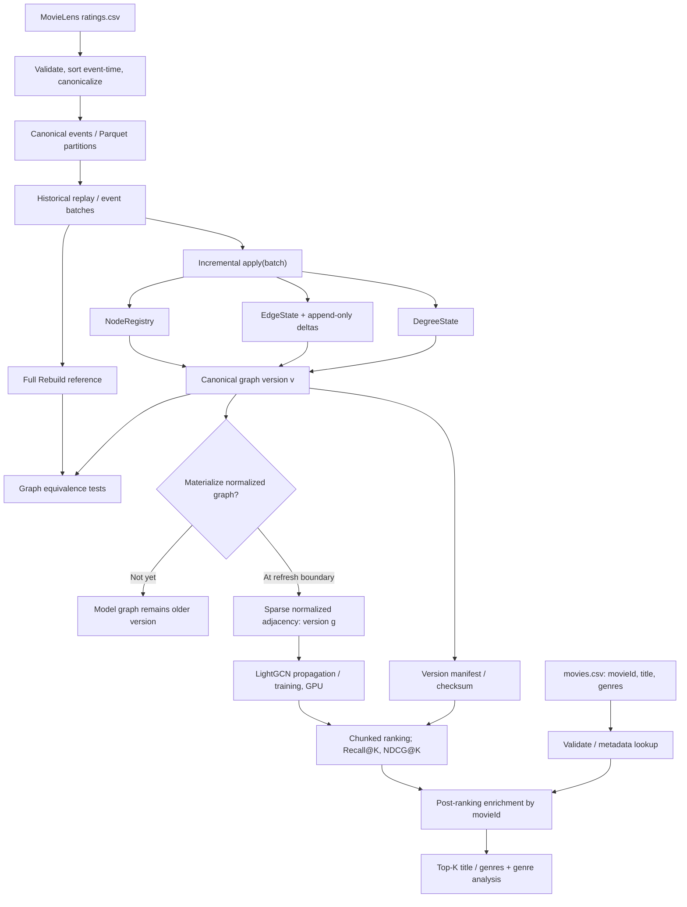

# 03 — Kiến trúc nghiên cứu v2.0

> Phần v2.0 dưới đây là nguồn sự thật hiện hành về kiến trúc. Nội dung DXX/EXP-01/EXP-02 ở phía dưới được giữ làm lịch sử, bao gồm tên RQ cũ và kế hoạch cũ; không dùng chúng để xác định phạm vi v2.0. Xem [audit và migration record](architecture-audit-v2.md) để phân biệt code đã có và công việc còn thiếu.

## Mục tiêu và luồng chính

**RQ1:** Khi nào Incremental Graph Update đạt trạng thái tương đương Full Rebuild với chi phí thấp hơn? **RQ2:** Stale Model, Propagation-only và Fine-tuning/Retraining đánh đổi thế nào về chi phí, độ mới và chất lượng? Chu kỳ normalized snapshot là engineering study hỗ trợ. Graph là cumulative historical-positive, `rating >= 4.0`. Cutoff 01/01/2020 là giả thuyết, chưa chốt. Quy mô graph engineering và LightGCN training được quyết định riêng.

```text
MovieLens -> Canonical Events -> Base Graph -> Replay Batches
          -> Graph Maintenance -> Graph Snapshot -> Model Refresh
          -> Temporal Evaluation -> Research Dashboard
```

| Module | Trách nhiệm và public API hiện có | Input → output; dependency | Kiểm thử / trạng thái |
| --- | --- | --- | --- |
| Data ingestion & replay | `src/ingest/d02_profile.py:run` profile và canonicalize; replay slicing hiện ở `src/benchmarking/common.py:slice_events` | `ratings.csv` → ordered Parquet với `event_id,event_ts,user_raw_id,movie_raw_id,rating,source_row_id`; DuckDB | `test_d02`; historical cutoff profiling và API replay tổng quát **chưa có** |
| Graph engine | `src/graph/full_builder.py:rebuild`, `incremental.py:IncrementalGraph.apply_batch`, `equivalence.py:compare_states` | Canonical Parquet → Full Parquet hoặc transactional DuckDB state; DuckDB | `test_full_builder`, `test_incremental`, `test_equivalence`; input validation gap ghi trong audit |
| Snapshot manager | `src/graph/snapshot.py:materialize_normalized`, `export_snapshot`, `load_export`, `freshness`; `normalize.py:normalize_state` | Canonical state version `v` → immutable normalized COO snapshot `g=v`, manifest/hash; graph engine | `test_normalization`, `test_snapshots` |
| LightGCN engine | `src/models/lightgcn.py:LightGCN`, `to_sparse_tensor`, `pairwise_loss`; `rec01_train.py:run` and `rec01_inference.py:load_rec01_inference` are fixed REC-01 workflows | Snapshot + checkpoint → propagated embeddings/Top-K; PyTorch, snapshot, evaluation | `test_lightgcn`, REC-01 tests; generic refresh engine **chưa có** |
| Evaluation & benchmarking | `evaluation/temporal.py`, `evaluation/rec01.py`; `benchmarking/exp01.py`, `exp02.py` | Train-only graph/model + future labels → Recall/NDCG; same-watermark graph runs → cost/correctness CSV | temporal leakage and toy EXP tests; v2 refresh experiment **chưa chạy** |
| Research dashboard | `src/app/streamlit_app.py:main`, `feedback.py:FeedbackStore` | Verified REC-01 bundle + local ratings → Top-20 and graph demo; loader and graph engine | S09–S11 tests; v2 research results view **chưa có** |

### Version and artifact contract

- **Canonical graph version `v`:** `applied_batches.graph_version` after a committed batch; watermark is last canonical `event_id`. Repeating the same batch is `NO_OP`; conflicting payload is rejected.
- **Model graph version `g`:** immutable normalized snapshot of canonical state exactly at `v=g`, with its own registry, COO, watermark and checksums. `g` may lag current `v`.
- **Checkpoint/source version `c`:** training checkpoint records model graph version, source/config hashes, train cutoff, parameters and selected step. REC-01 uses graph version 81 and a fixed 1M protocol; this is historical, not a v2 refresh result.
- **Propagated embeddings version `p`:** proposed contract `(checkpoint hash, checkpoint graph version c, snapshot graph version g, node-map compatibility, propagation config/hash)`. No persisted v2 `p` artifact exists yet. For a stale result, `g=c`; propagation-only would use frozen parameters from `c` with a newer compatible `g`. New nodes need an explicit initialization/masking policy before this can be measured. Fine-tuning requires a new checkpoint and resource budget.

### Next implementation gates

1. [Full temporal profiling](temporal-profile-v2.md) đã hoàn thành; cutoff 2020 và replay windows đang chờ Project Owner review trước benchmark. Preserve original data.
2. Validate canonical event IDs, raw IDs, tie ordering and stable registry/degree/full-equivalence on toy and selected real prefixes. Preserve existing threshold and cumulative semantics.
3. Measure a one-T4 16 GB GPU workload on a small increasing graph sample: peak VRAM, propagation/training time, checkpoint bytes and OOM boundary. Choose model scale from measurement.
4. Define a versioned refresh interface: `stale(checkpoint, old_snapshot)`, `propagate(checkpoint, new_snapshot)`, and optional `fine_tune(checkpoint, new_snapshot, budget)`. Record `v,g,c,p`, cutoff, candidate universe and timing per result. Do not implement or claim freshness results before these gates pass.

## Lịch sử thiết kế DXX/SXX (lưu để đối chiếu)

> **Phạm vi sprint mới 21/11/2026:** sơ đồ dưới đây mô tả lõi graph/LightGCN đã xây. [Định hướng v1.0](10-direction-update-v1.md) bổ sung Streamlit, REC-01 Popularity/Top-20 và checkpoint selection vào MVP; [S01](s01-evaluation-spec.md) là giao thức đã duyệt, [S04](s04-rec01-results.md) ghi kết quả trên prefix 1M và [S09](s09-streamlit-mvp.md) ghi UI snapshot chỉ đọc.

> Đã triển khai và kiểm chứng D01–D07. LightGCN sparse smoke đạt trên CUDA. Temporal evaluation và benchmark thuộc các milestone sau. Cập nhật 20/11/2026.
> **Nguyên tắc:** correctness → reproducibility → performance. Mọi interface đều là đề xuất để kiểm thử và tinh chỉnh.

## 1. Kiến trúc logic



**Physical scope:** một máy cho DE benchmarks; GPU laptop hoặc Kaggle có thể dùng cho LightGCN. Các phương án benchmark Full/Incremental phải đo trên **cùng** máy/cấu hình. Đây **không phải** kiến trúc stream production, không có broker bắt buộc.

**Ranh giới metadata:** `movies.csv` là nhánh lookup đầu ra; nó **không** tham gia tạo cạnh, degree, normalization, hay training input của LightGCN ở MVP.

## 2. Data contract — thô, canonical và positive graph

### 2.1 Source: `ratings.csv`

| Field | Kiểu | Nghĩa |
|---|---|---|
| userId | integer | user gốc |
| movieId | integer | movie gốc |
| rating | float | thang điểm 0.5–5 |
| timestamp | integer seconds | event-time |

Kiểm tra: đúng header, kiểu, null, miền rating, timestamp hợp lệ, `(userId,movieId)` trùng hoặc timestamp trùng. Không suy ra dữ liệu source đã được sắp theo thời gian: **explicit sort**.

### 2.2 Canonical event schema

```text
event_id: int64            # thứ tự deterministic sau sort
event_ts: int64            # Unix timestamp
user_raw_id: int64
movie_raw_id: int64
rating: float32
is_positive: bool         # config threshold, ví dụ rating >= 4.0
source_row_id: int64      # thứ tự hàng CSV gốc, tie-break ổn định
batch_id: int32           # gán khi replay; không phải trường gốc
```

**Thứ tự ổn định:** `ORDER BY timestamp, userId, movieId, source_row_id`. Sau khi sort, cấp `event_id` từ 0. Nếu dòng giống nhau hoàn toàn nhưng khác `source_row_id`, chúng vẫn là **hai events**, sau đó graph edge sẽ được khử trùng lặp theo quy tắc riêng. Lưu `dataset_id`, input checksum và transform config.

### 2.3 Từ event sang graph edge

- Bảo toàn toàn bộ raw/canonical events để benchmark ingestion; **positive graph** chỉ lấy event `rating >= threshold`.
- `EdgeKey = (user_raw_id, movie_raw_id)` trong MVP là **unweighted binary historical-positive graph**, một cặp chỉ xuất hiện tối đa một lần; đã insert thì vẫn tồn tại trong positive-edge state. Như vậy đồ thị mang nghĩa *đã từng có tương tác dương*.
- Không tự ý coi rating lại thành thao tác delete/update cạnh. Nếu phát hiện vấn đề recency / rating edits, ghi DEC mới và mở rộng sau MVP.
- `events_processed` khác `positive_edges_inserted`; luôn log cả hai.

### 2.4. Source metadata: `movies.csv` và hợp đồng hậu xử lý

| Field | Kiểu logic | Cách dùng |
|---|---|---|
| `movieId` | integer | JOIN key từ `ratings.movieId` / `movie_raw_id` |
| `title` | string | Hiển thị tên phim; không tự động suy ra release year chính xác |
| `genres` | string (`|`-delimited) | Phân tích mô tả danh mục đa nhãn, không tạo graph edge |

**Ingest metadata:** đọc `movies.csv` riêng; validate header/kiểu, `movieId` non-null và unique, xử lý trường hợp `(no genres listed)` như nhãn đặc biệt/unknown; giữ `movies_source_hash`/`movies_transform_version` riêng trong provenance. Không JOIN raw `ratings × movies` trước graph builder vì sẽ thay I/O contract và che mất benchmark cốt lõi.

**Hậu xử lý recommendation:** sau khi `score_chunks()` trả `user_raw_id`, `movie_raw_id`, `rank`, `score` và version, LEFT JOIN `movies` theo raw `movieId` để bổ sung `title`, `genres`, `metadata_found`. Dùng LEFT JOIN để không làm mất recommendations khi metadata thiếu. Dù bảng metadata có duplicate, pipeline phải **fail validation trước JOIN**, không chấp nhận nhân đôi Top-K rows.

**Output contract:**

```text
user_raw_id: int64
movie_raw_id: int64
rank: int32
score: float32 or float64
title: string nullable
genres: string nullable
metadata_found: bool
canonical_version: int32
model_graph_version: int32
model_checkpoint_version: int32
```

**Các test bổ sung:** (T-10) `movieId` unique và coverage được báo cáo; (T-11) cùng input Top-K, JOIN giữ nguyên `user,item,rank,score`, số dòng và thứ tự; (T-12) các đánh giá Recall@K/NDCG@K được tính **trước hoặc độc lập** với JOIN metadata và không thay đổi. Các phân tích genre (frequency, catalog coverage, diversity minh họa) chỉ là mô tả sau hoc, không kết luận LightGCN sử dụng hoặc hiểu semantics `genres`.

**Mở rộng tương lai:** dùng `genres` làm features, thêm Genre node hoặc reranking là nghiên cứu khác, cần ADR/ablation riêng; không nằm trong scope 21 ngày.

## 3. NodeRegistry và ID ổn định

```text
node_id: int64            # monotonic 0...N-1, cấp theo lần xuất hiện
node_type: user | movie
raw_id: int64
first_event_id: int64
first_event_ts: int64
created_version: int32
```

Unique constraints: `(node_type,raw_id)`, `node_id` unique. **Không** offset `movie_id` bằng số lượng user hiện tại rồi thay offset khi user mới tới. Dùng một không gian node_id ổn định, cấp liên tiếp cho **positive graph nodes** khi lần đầu insert edge. Khi tạo tensor model tại snapshot, có thể ánh xạ `graph_node_id → model_index` cố định trong checkpoint; việc thêm node sau checkpoint không thể dùng base embedding cũ nên EXP-03 chỉ dùng **warm node IDs**.

## 4. Mutable state và giao dịch phiên bản

**Implementation D04:** [incremental.py](../src/graph/incremental.py) hiện thực graph state và batch ledger trong một DuckDB transaction. Input, batch hash contract, watermark, hành vi NO_OP và giới hạn publish/recovery được ghi ở [D04](d04-incremental.md). Schema SQL dưới đây là thiết kế gốc; implementation bổ sung ledger event counts và last order key để kiểm tra boundary. DB ledger là nguồn version của D04, chưa xuất model snapshot manifest.

### 4.1 State schema gợi ý

```sql
CREATE TABLE IF NOT EXISTS node_registry (
  node_id BIGINT PRIMARY KEY,
  node_type VARCHAR NOT NULL,
  raw_id BIGINT NOT NULL,
  first_event_id BIGINT NOT NULL,
  created_version INTEGER NOT NULL,
  UNIQUE(node_type, raw_id)
);
CREATE TABLE IF NOT EXISTS edge_state (
  user_node_id BIGINT NOT NULL,
  movie_node_id BIGINT NOT NULL,
  first_event_id BIGINT NOT NULL,
  created_version INTEGER NOT NULL,
  PRIMARY KEY(user_node_id, movie_node_id)
);
CREATE TABLE IF NOT EXISTS degree_state (
  node_id BIGINT PRIMARY KEY,
  degree BIGINT NOT NULL,
  updated_version INTEGER NOT NULL
);
CREATE TABLE IF NOT EXISTS applied_batches (
  batch_id INTEGER PRIMARY KEY,
  min_event_id BIGINT NOT NULL,
  max_event_id BIGINT NOT NULL,
  batch_hash VARCHAR NOT NULL,
  graph_version INTEGER NOT NULL
);
```

**Storage:** mutable metadata/state có thể để trong một DB DuckDB local; canonical batches/delta exports ở Parquet. Benchmark cần ghi rõ materialization/export nào **bắt buộc với cả hai phương pháp** và phần nào riêng strategy, tránh so sánh hai output khác nhau.

### 4.2 Invariants

1. `node_id` không thay đổi qua versions.
2. Mỗi `(user,movie)` có tối đa một edge.
3. `degree_state[n] ==` số cạnh incident với `n`.
4. Với bipartite graph: `sum user degrees == |E| == sum movie degrees`.
5. Reapply cùng `batch_id` + `batch_hash` không thay đổi state; cùng ID khác hash → reject.
6. Event watermark tăng đơn điệu; không dùng dữ liệu vượt watermark khi build.
7. Graph version được publish chỉ khi state, manifest, checksum nhất quán.
8. Đồ thị Full và Incremental tại cùng watermark có **cùng node IDs** nếu cùng chính sách cấp ID; test edge-set/degrees bằng canonical keys và mapping.

### 4.3 Commit/recovery

Trình tự gợi ý: validate input → begin transaction → check batch ledger → allocate unseen nodes → insert unseen edges → update degrees theo inserted edges → register batch → commit → xuất manifest vào file tạm → atomic rename. Trường hợp crash giữa DB commit và manifest publish phải có cơ chế **reconcile từ batch ledger**, không mặc định atomic giữa transaction DB và file system.

**Checkpoint:** snapshot trạng thái tại version `k` và replay deltas `k+1..v`; chỉ thêm full compaction experiment nếu thực tế gặp small-files overhead.

## 5. Full vs Incremental algorithms

**Kiểm chứng D05:** [equivalence.py](../src/graph/equivalence.py) đối chiếu exact logical registry/edge/degree, không dùng số lượng làm đại diện cho equality. Harness rebuild reference tại từng batch boundary và kiểm tra replay giữ nguyên full state. G1 PASS trên toy/100k, 4 segmentation mỗi dataset; setup, version projection và giới hạn ở [D05](d05-equivalence.md).

```python
# Reference (conceptual pseudocode)
def full_rebuild(events_through_watermark, config):
    selected = filter_positive(events_through_watermark, config.threshold)
    registry = deterministic_assign_on_first_positive_edge(selected)
    edge_set = deduplicate_user_movie_pairs(selected)
    degrees = count_incident_edges(edge_set)
    return canonical_state(registry, edge_set, degrees)

# Optimized path (conceptual pseudocode)
def apply_batch(prior_version, batch):
    assert_valid_and_monotonic_batch(batch)
    if same_batch_already_committed(batch.id, batch.hash):
        return prior_version  # idempotency
    assert_no_conflicting_batch(batch.id, batch.hash)
    new_edges = filter_positive_and_antijoin_existing_pairs(batch)
    register_unseen_endpoints(new_edges)  # stable IDs
    insert_edges(new_edges)
    increment_degree_only_for_inserted_edges(new_edges)
    record_batch_and_commit()
    return publish_manifest()
```

**Thực thi:** có thể dùng SQL `INSERT ... ON CONFLICT DO NOTHING`/anti-join; cập nhật DegreeState dựa trên tập **đã insert thực tế**, không dựa số dòng positive trước dedup. Benchmark cả overhead giao dịch.

## 6. Materialize model-ready LightGCN operator

**Implementation D06:** [normalize.py](../src/graph/normalize.py) materialize COO float64, kiểm tra degree/edges và normalize một lần. [snapshot.py](../src/graph/snapshot.py) lưu node map, weights và manifest theo source version; `freshness()` báo current canonical/model graph versions riêng. T-05 dense toy + SQL Full reference và T-06 stale/export/reopen đã PASS; [D06](d06-normalization.md) ghi scope/tolerance và DEC-015 ghi representation contract. GPU/framework operator chưa kiểm chứng đến D07.

Trên canonical snapshot \(G_v\), tính degree \(d_j\), duyệt edges và tạo sparse adjacency **đối xứng**:

\[
\tilde A^{(v)}_{ui}=\tilde A^{(v)}_{iu}=\frac{1}{\sqrt{d^{(v)}_u d^{(v)}_i}}.
\]

Không thêm self loops nếu đang mô phỏng công thức LightGCN gốc; cần kiểm tra PyG operator không chuẩn hóa **hai lần** khi đã truyền `edge_weight` chuẩn hóa từ trước. Chọn **một** nơi chịu trách nhiệm normalization và có toy graph test so sánh reference.

**Khác biệt cốt lõi:** canonical graph vẫn chính xác ở mỗi version; normalized adjacency được kết xuất ở versions `v ∈ {R, 2R,...}`. Đối với `R=1` — eager, `R=5`, `R=20` — deferred, so sánh normalized operator **chỉ ở common refresh boundaries** từ cùng canonical graph.

Nếu dùng factorized propagation \(D^{-1/2} A D^{-1/2}X\), ghi rõ liệu thí nghiệm đo **materialization của sparse normalized weights** hay chi phí tính từng lần trong propagation; hai thiết kế có giá thành khác nhau và không được nhập nhằng.

## 7. Manifest version schema

```json
{
  "canonical_version": 42,
  "parent_version": 41,
  "applied_batch_id": 42,
  "watermark_event_id": 1234567,
  "max_event_ts": 1690000000,
  "all_events_seen": 1234568,
  "positive_edge_count": 800000,
  "user_node_count": 15000,
  "movie_node_count": 9000,
  "registry_sha256": "PLACEHOLDER",
  "edge_sha256": "PLACEHOLDER",
  "degree_sha256": "PLACEHOLDER",
  "model_graph_version": 40,
  "model_checkpoint_version": 20,
  "config_sha256": "PLACEHOLDER",
  "git_commit": "PLACEHOLDER"
}
```

**Ví dụ schema, không phải dữ liệu đã đo.** `canonical_version`/`model_graph_version`/`model_checkpoint_version` khác nhau là hợp lệ nếu refresh được trì hoãn. Không dùng các trường version để ngụy trang graph sai.

## 8. Model integration, temporal evaluation và prevention of leakage

[LightGCN D07](../src/models/lightgcn.py) nạp COO từ D06 dưới dạng float32 và dùng sparse matrix multiplication để lan truyền. Toy reference xác nhận kết quả sau khi chuyển dtype. Toy, 100k và 1M đều chạy CUDA forward/backward và Adam. Cấu hình và bộ nhớ đo được có trong [D07](d07-lightgcn-smoke.md).

1. Tách lịch sử chronological thành train/validation/test **bằng thời gian**, ưu tiên cutoff nhất quán. Không random edge split vì sẽ leak future links.
2. Tạo train graph và degree **chỉ từ train prefix** khi đánh giá tại cutoff. Registry cho train model không được dùng validation/test để tính degrees.
3. Chỉ đánh giá những user/item đã có base embeddings nếu so sánh propagation-only; báo cáo tỷ lệ bị loại khỏi warm cohort.
4. Trong từng evaluation cutoff `t`, **mọi phương án** chỉ xem được events `<= t`; ground truth là future positives trong cửa sổ `(t, t+h]`. Không dùng future history để update graph trước đánh giá.
5. Tạo negatives cho BPR từ catalog và interactions **đã quan sát** đến cutoff; mask item train-seen trong ranking; ghi rõ candidate universe và whether filtered all known positives.
6. Baselines: Popularity, BPR-MF, LightGCN. Cố định số epoch, embedding dimension, seed/grid vừa sức; không bắt LightGCN phải thắng.
7. Khi số node mới vượt embedding rows của checkpoint, phải reject hoặc rẽ sang fallback; MVP EXP-03 giới hạn warm nodes.

### Chiến lược so sánh freshness (EXP-03)

- **Stale:** graph+propagated embeddings ở version cũ.
- **Propagation-only:** base embeddings đã học **đóng băng**, propagation trên graph version mới (warm cohort).
- **Periodic trained reference:** huấn luyện/tối ưu checkpoint dùng events cho phép đến `t`, theo fixed budget; không coi là online training luôn chạy.

Đo both computational expense + Recall/NDCG trên **cùng temporal future target**.

## 9. CPU/GPU memory boundary

- CPU: parse, sort, Parquet/DuckDB, registry, degree, edge state, manifest, normalization materialization và equivalence.
- GPU: training LightGCN/BPR-MF, propagation, chunked ranking; không dựng `all_users × all_items` scores matrix.
- GPU profile tách `forward`, `backward`, `short train`, `evaluation`; `torch.cuda.max_memory_allocated` và `max_memory_reserved` sau `reset_peak_memory_stats` và sync.
- Tránh `edge_index` gather-scatter toàn bộ edges × embedding dimension nếu OOM; ưu tiên sparse SpMM/CSR khi tương thích backward, xác nhận bằng probe nhỏ.

## 10. Interfaces / modules dự kiến

```text
src/
  ingest/validate.py           validate_source()
  ingest/canonicalize.py       build_canonical_parquet()
  ingest/replay.py             batches_from_watermark()
  graph/full_builder.py        full_rebuild()
  graph/incremental.py         apply_batch()
  graph/registry.py            NodeRegistry
  graph/degree.py              DegreeState
  graph/snapshot.py            publish_version(), recover()
  graph/normalize.py           materialize_normalized(version)
  models/lightgcn.py           fit(), propagate(), score_chunks()
  models/bpr_mf.py             fit(), score_chunks()
  evaluation/temporal.py       cutoff_cohort(), evaluate_topk()
  metadata/movie_lookup.py     load_movies(), validate_movies(), enrich_topk(), genre_profile()
  benchmarking/runner.py       repeat_isolated_runs()
  benchmarking/metrics.py      time/rss/cuda/provenance
  tests/test_graph_equivalence.py
  tests/test_idempotency.py
  tests/test_normalization.py
  tests/test_temporal_leakage.py
  tests/test_metadata_enrichment.py
```

Các tên hàm là **hợp đồng thiết kế**, không biểu thị đã viết code. `metadata` là tầng post-ranking không làm thay đổi core graph pipeline.

## 11. Test matrix (gắn milestone)

| Test | Điều kiện pass | Hạn |
|---|---|---|
| T-01 replay | cùng input/config tạo cùng event ordering/checksum | D02 |
| T-02 graph equivalence | registry/edges/degrees khớp full reference | D05 |
| T-03 idempotency | replay batch hai lần không thay đổi state | D05 |
| T-04 recovery | checkpoint+delta == direct replay ở version N | D09–D16 |
| T-05 normalization | exact weights với toy graph; full vs incremental same `v` trong tolerance | D06 |
| T-06 version semantics | canonical version > model-graph version được log, không lẫn dữ liệu | D06 |
| T-07 temporal isolation | no valid/test edges in training graph, degrees, negatives | D08 |
| T-08 ranking | chunked eval tương đương full small reference | D09 |
| T-09 OOM/failure | ghi nhận lỗi và fallback an toàn | D10 |
| T-10 metadata keys | `movies.movieId` unique; thiếu metadata được thống kê | D09 |
| T-11 enrichment invariance | LEFT JOIN không thay user/item/rank/score hoặc số rows | D09 |
| T-12 metrics isolation | Recall/NDCG độc lập với genres/title | D10 |

Tham chiếu: [01 — Charter](01-project-overview.md) · [04 — Tasks](04-project-plan.md) · [07 — Thí nghiệm](07-experiment-log.md).
