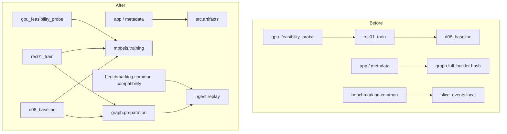

# GOAL 03.5 — Implementation và review

Ngày 22/11/2026. Branch `refactor/v2-cleanup` tạo từ `refactor/v2-architecture` HEAD `cec72b8ddbad76f5788cc37cd0e30fce6624f282`, giữ audit files chưa commit. Không commit, push, merge; không training quy mô lớn hoặc triển khai Model Refresh Engine.

## Trước và sau

| Trước | Sau | Vì sao |
| --- | --- | --- |
| REC-01 loader yêu cầu sáu Python files trùng byte với report | Chỉ giữ source hashes lịch sử làm provenance; vẫn kiểm checkpoint SHA-256, config, graph export/normalization, node map và strict state dict | Code có thể refactor mà sealed checkpoint vẫn an toàn |
| `rec01_train → d08_baseline` cho train graph; GPU probe → REC-01 private sampler; BPR step lặp | `graph.preparation` sở hữu train graph; `models.training` sở hữu sampler và BPR step; D08/REC-01/probe cùng gọi core | GOAL 04 không phải phụ thuộc runner mốc cũ |
| Benchmark giữ `slice_events` và graph prep viết lại slicing | `ingest.replay.slice_events` là implementation duy nhất; benchmark common giữ re-export tương thích | Một quy tắc event range/ID không bị trôi lệch |
| File hashing đặt trong Full Builder; app/metadata import graph để hash | `src/artifacts.py:file_sha256`; Full Builder re-export tên cũ cho callers lịch sử | Bỏ dependency ngược tầng mà giữ import compatibility |
| Full Rebuild chấp nhận IDs `[0,1,1,3]`; D02 chấp nhận raw ID 0; output cũ bị ghi đè | DuckDB canonical validator, D02 raw-ID check và fresh-output guard | Reference và replay cùng contract; không ghi đè evidence |
| Kaggle runner timeout có thể báo `RUNNING` | Exit status ưu tiên `TIMEOUT` và `ERROR`; test trạng thái | Summary phản ánh thất bại thật |
| README/AGENTS/03-system-design lẫn quyết định hiện hành và kế hoạch cũ | `docs/current/` giữ scope, architecture, protocol, progress, walkthrough; `docs/research/README.md` là index; 31 hồ sơ cũ được gắn nhãn lịch sử | Người mới có một đường đọc v2, raw evidence còn nguyên |

Tree phần liên quan trước: `src/{ingest/d02_profile,graph/{full_builder,incremental,normalize,snapshot},models/{d08_baseline,rec01_train,rec01_inference,lightgcn},benchmarking/common,app}`; `scripts/gpu_feasibility_probe.py`; 49 Markdown tracked. Sau: giữ các entrypoints trên, thêm `src/artifacts.py`, `src/ingest/{canonical,replay}.py`, `src/graph/preparation.py`, `src/models/training.py`, `docs/current/` (5 files), `docs/research/README.md`, `src/benchmarking/gpu_feasibility.py` (probe implementation). Có 80 Python files (73 baseline + 6 core modules + 1 status test). Không di chuyển frozen report/checkpoint/raw metric files. [Map đầy đủ của 49 Markdown cũ](goal035-documentation-map.md).

`validate_events` dùng DuckDB window/aggregate và chỉ trả hai scalar counts, không đưa toàn bộ event rows sang Python. `benchmarking.exp01.worker` gọi validator **trước** `RssSampler` và timer cho cả hai phương pháp; `rebuild(validate=False)` chỉ dùng sau bước đó. Kiểm hash/batch ledger và rollback bên trong `IncrementalGraph.apply_batch` vẫn thuộc công việc cập nhật graph đang đo, giữ measurement boundary lịch sử. Không so timing mới với raw EXP-01 cũ như cùng một run.

[AST dependency edge inventory trước/sau](../../../results/goal035_baseline/post-refactor-verification.json) ghi thay đổi thực tế, không coi import cũ trong D09/D10/S02 là dead: đó là entrypoints lịch sử có tests/callers. Core graph/model mới không import các runner này. `src/models/d09_pipeline.py → d08_baseline`, `d10_mvp.py → d09_pipeline` vẫn được giữ để tái hiện protocol lịch sử; GOAL 04 dùng core.

## Verification và Ponytail review

Baseline: **68 PASS, 0 FAIL, 0 SKIP, 39,409 s**. Sau M1: 12 targeted tests PASS; selected sealed checkpoint graph v81/step 300 trả Top-20 IDs giống hệt cho users `2, 25062, 101198, 200939, 200940`, max score difference `0,0` với `atol/rtol=1e-6`. M2: 5 targeted tests PASS cho malformed canonical IDs, raw ID 0, output overwrite và EXP-01 contract; existing canonical 1M được SQL validator chấp nhận. M3: 14 targeted training/inference/probe tests PASS. M4: 3 runner/preparation tests PASS; timeout test dùng partial `RUNNING` report. M5: local Markdown file links đã kiểm trong 58 Markdown files, 0 broken; anchor/remote URL verification có giới hạn. Full regression sau M4 và replay extraction: **72 PASS, 0 FAIL, 0 SKIP, 33,492 s**. Full regression sau BPR extraction: **72 PASS, 0 FAIL, 0 SKIP, 33,888 s**. Full regression sau graph preparation cleanup: **72 PASS, 0 FAIL, 0 SKIP, 33,653 s**. Sau artifact schema và negative tests: **74 PASS, 0 FAIL, 0 SKIP, 33,591 s**. Full regression cuối sau GPU probe move và shared hash cleanup: **74 PASS, 0 FAIL, 0 SKIP, 33,695 s**. Toy BPR training sau extraction giữ exact Top-20 IDs, max score difference 0,0.

Small end-to-end toy sau tất cả thay đổi source: raw CSV 30 rows → canonical events → Full/Incremental exact equivalence → snapshot → 2 BPR steps/validation selection → held-out evaluation → inference Top-20: **PASS**; [before](../../../results/goal035_baseline/smoke-before.json) / [after](../../../results/goal035_baseline/smoke-after.json) giữ exact Top-20 IDs và max score difference **0,0**. REC-01 old/new same artifact comparison: **PASS**, max score difference **0,0** cho 5 users; [before](../../../results/goal035_baseline/rec01-before.json) / [after](../../../results/goal035_baseline/rec01-after.json). Original raw datasets, canonical prefixes, raw experiment CSVs, frozen report/manifest và sealed checkpoint giữ nguyên; 20 protected files và 9 selected sealed bundle files đã so SHA-256 với baseline. `verify_output` riêng kiểm đủ 97 files REC-01 trước refactor; [artifact evidence](../../../results/goal035_baseline/artifact-verification-before.json).

Ponytail-review M1: kiểm loader, selected checkpoint, graph normalization, node mapping, tensor shapes và callers app; finding test gap tensor/config đã được xử lý bằng mutated toy copies, giữ SHA-256 artifact. M2: kiểm D02/Full/Incremental/benchmark callers và negative fixtures; finding benchmark validator trong timer đã được sửa bằng prevalidation ngoài `worker` timer, không materialize toàn bộ events vào Python. M3–M4: kiểm import graph/runner, sampler sequence, source provenance, timeout; xử lý duplicate sampler/slicing, BPR step, file-hash helpers, normalization bị bỏ đi và timeout. Final review: xem diff, connected callers, tests, protected hashes và docs links; **không còn MUST FIX đã biết trong phạm vi thay đổi**. Những giới hạn còn lại ở phần debt.

## Remaining debt / quyết định giữ lại

- `graph.snapshot.materialize_normalized` hiện tạo full Python state/COO trước SQL snapshot. Workload đã chốt có T4 feasibility evidence, nhưng chưa có phép đo cho việc đổi backend normalization; không tự thay numerical/benchmark behavior.
- `evaluation.temporal.score_chunks` xếp hạng theo từng user/chunk; latency cho full v2 cohort chưa đo. Không suy từ probe 100 users.
- `app.feedback` dùng single-process writer, phù hợp demo hiện tại; không phải multi-server deployment.
- Historical D09/D10/S02 wrappers/probes giữ dependency tới D08 để tái hiện; current REC-01 training và GPU probe core đã tách. `scripts/gpu_feasibility_probe.py` là CLI wrapper. Kaggle bootstrap runner tự hash source trước khi project code được copy, nên giữ helper độc lập.
- `checkpoint.py` trong target sketch chưa được tạo: hiện chưa có second production checkpoint format/refresh caller. REC-01 loader giữ strict contract và report mới ghi `artifact_schema=rec01-v1`; legacy report thiếu field được nhận là v1, schema khác bị từ chối. Tạo abstraction checkpoint chung khi GOAL 04 có protocol cụ thể sẽ tránh speculative API.
- `docs/final-report.md`, S12 manifest và submission ZIP cũ là frozen historical artifacts. `docs/03-system-design.md` và DXX/SXX files giữ path/content để các claim links trong report còn dùng; đầu file gắn nhãn lịch sử. Chưa kiểm remote links/papers hoặc render lại DOCX/PDF.

## GOAL 04 readiness

Graph preparation, replay, snapshot, LightGCN sampler và REC-01 compatibility được tách khỏi milestone-specific runtime. GOAL 04 có thể bắt đầu từ những APIs này sau nghiệm thu; còn cần quyết định policy new nodes, checkpoint/artifact version mới, propagated embeddings version `p`, fixed temporal candidates và refresh budgets trước thí nghiệm RQ2. Không dùng checkpoint REC-01 prefix 1M như model cho cohort v2 5M vì node mapping/protocol khác.
