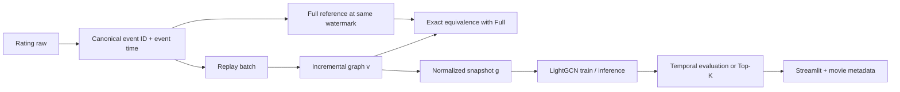

# Architecture Walkthrough — BigDataProject v2

## 1. Các module và lý do tồn tại

| Module | Input → output | Vì sao cần |
| --- | --- | --- |
| `src/ingest/d02_profile.py`, `canonical.py` | MovieLens `ratings.csv` → canonical Parquet có `event_id`/thứ tự xác định | Để Full và Incremental đọc đúng cùng một lịch sử, không phụ thuộc thứ tự CSV |
| `src/graph/full_builder.py` | Canonical prefix → registry/edges/degrees reference | Đường độc lập để kiểm sự đúng đắn của cập nhật tăng dần |
| `src/graph/incremental.py` | Canonical batches → DuckDB state/version ledger | Chỉ thêm positive edges mới, hỗ trợ replay idempotent và rollback |
| `src/graph/equivalence.py` | Hai logical states → so từng row/hash | Chứng minh RQ1 trước khi so chi phí |
| `src/graph/normalize.py`, `snapshot.py` | Graph version `v` → immutable normalized sparse COO version `g` | LightGCN cần trọng số theo degree; `g` có thể cũ hơn `v` |
| `src/models/lightgcn.py`, `training.py` | COO + train triples → propagated embeddings/checkpoint | Học vector user/movie bằng BPR; model không tự thay sau một graph update |
| `src/models/rec01_inference.py` | Sealed REC-01 bundle + movies CSV → Top-20 | Nạp checkpoint tương thích và xếp hạng theo train catalog, thêm metadata sau ranking |
| `src/evaluation/*` | Train graph, future labels → warm cohort/Recall/NDCG/Popularity | So chất lượng mà không đưa future labels vào train |
| `src/benchmarking/*`, `src/app/*` | Core APIs → số đo RQ1/cadence và Streamlit demo | Tách nghiên cứu, hiển thị khỏi thuật toán lõi |

`src/benchmarking/gpu_feasibility.py` là workload probe cho T4; `scripts/gpu_feasibility_probe.py` là CLI tương thích và không phải model refresh experiment. DXX/SXX runners vẫn tái hiện lịch sử. `src/artifacts.py` chỉ hash file bytes cho provenance/integrity.

## 2. Một rating đi qua hệ thống

Ví dụ: trước batch có cạnh `(u=1, phim=10)` từ rating 4,5. Batch mới gồm `(1,10,5,0)` và `(1,20,4,0)`. Event đầu **không** thêm cạnh vì cặp đã có; event sau thêm đúng một cạnh. Degree user 1 tăng một, degree phim 20 tăng một; `v` tăng một batch. Replay đúng batch ID và payload trả `NO_OP`. Nếu batch lỗi giữa transaction, state/degree/ledger quay về trước batch. Full Rebuild ở cùng watermark phải cho cùng registry, edges và degrees. Snapshot `g` chỉ đổi khi materialize, lúc đó trọng số các cạnh kề user 1 phải được tính lại bằng `1/sqrt(d_u*d_i)`.

Rating dưới 4,0 vẫn là canonical event nhưng không tạo positive edge. Cumulative graph không xóa cạnh cũ khi có rating mới thấp hơn. Source CSV không được giả định sắp theo thời gian; khi timestamp trùng, sort theo user/movie/source row để có một thứ tự ổn định.

## 3. Training, inference và model freshness

Training tạo graph chỉ từ train events, materialize snapshot, khởi tạo embeddings rồi lấy BPR triples `(user, phim positive, phim chưa thấy)` theo seed. `LightGCN.forward` lấy trung bình embedding ban đầu và các lớp lan truyền. Sau optimizer steps, validation chọn checkpoint; test labels chỉ được đọc sau khi chọn. Inference nạp checkpoint và **cùng model graph/mapping/config**, truyền COO qua model, che train-seen movies, xếp hạng Top-20 theo raw movie ID khi score bằng nhau. Cold user dùng Popularity từ train graph. `movies.csv` chỉ enrich title/genres sau ranking.

Trong demo hiện có, `FeedbackStore` sao chép graph lịch sử REC-01 ra nhánh riêng rồi apply rating; checkpoint và recommendation embeddings vẫn từ REC-01. UI vì vậy hiện staleness. **GOAL 04 mới sẽ tích hợp Model Refresh Engine** giữa graph snapshot mới và inference/evaluation: so stale (`g=c`), propagation-only trên snapshot mới với tham số cố định, và fine-tune/retrain theo budget đã duyệt. `p` phải chỉ rõ checkpoint hash, graph snapshot, node map và propagation config. Đây là vị trí thiết kế, chưa có engine hay kết quả chất lượng RQ2.

REC-01 dùng prefix 1M và temporal cutoffs lịch sử; v2 dùng base `< 2020-01-01 00:00 UTC`, replay `>=`. Hai graph có thể có node ID conventions khác nhau, nên không dùng checkpoint REC-01 như model cho cohort 5M. Workload 5M/T4 đã được đo về tài nguyên, chưa chứng minh quality hoặc refresh strategy.

## 4. Tự kiểm tra

1. Vì sao một rating positive mới cho cặp đã tồn tại không tăng degree, nhưng vẫn làm batch ledger tiến version?
2. Khi `v=10`, `g=5`, checkpoint train ở `c=5`, Top-20 hiện tại phản ánh graph nào? Cần bước gì trong GOAL 04 để dùng snapshot `g=10`?
3. Vì sao chỉ so Full/Incremental ở cùng event watermark, và vì sao validation của canonical input phải ở ngoài timer benchmark RQ1?

[Scope/decisions](scope-and-decisions.md) · [Architecture contracts](architecture.md) · [Protocol](experiment-protocol.md) · [Research evidence](../research/README.md).
