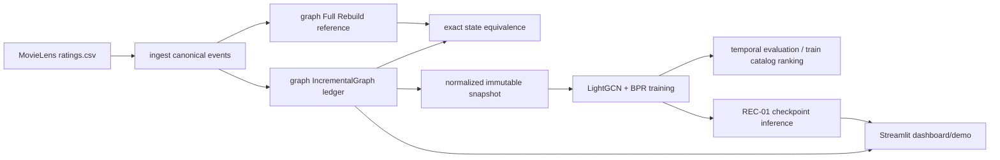

# Kiến trúc v2 hiện hành

`src/ingest/d02_profile.py` canonicalize theo `(event_ts,user_raw_id,movie_raw_id,source_row_id)` và gán `event_id` tăng liên tục. `src/ingest/canonical.py` kiểm schema, ID, domain và thứ tự trong DuckDB. `src/graph/full_builder.py` là reference; `incremental.py` dùng transaction, unique edges, stable registry IDs, degree state và batch ledger. `equivalence.py` so toàn bộ logical rows. `preparation.py` chuẩn bị graph chỉ từ train events. `normalize.py` tạo `D^-1/2 A D^-1/2`; `snapshot.py` materialize/export snapshot version và hash.

`src/models/lightgcn.py` giữ phép lan truyền 3 lớp/mean với embedding ban đầu và BPR loss. `models/training.py` có deterministic triple sampler và BPR optimizer step dùng chung. `models/rec01_train.py` là runner protocol **lịch sử**; `rec01_inference.py` nạp artifact sealed và xếp hạng train catalog. `evaluation/temporal.py`, `rec01.py`, `baselines.py` giữ split/cohort/mask/Recall/NDCG/Popularity. `benchmarking/exp01.py` đo RQ1; `exp02.py` đo snapshot cadence; `gpu_feasibility.py` chứa probe workload T4. Streamlit ở `src/app`; feedback branch cập nhật graph nhưng vẫn giữ checkpoint cũ.

Version `v` là canonical graph sau một batch; `g` là immutable normalized snapshot version; checkpoint `c` ghi graph/config đã dùng. `p` (propagated embeddings version) là contract **thiết kế cho GOAL 04**, chưa có artifact v2. `g` có thể chậm hơn `v`, nhưng snapshot không được gắn nhãn version cũ cho graph mới. Candidate mask chỉ dùng train events. Cần policy riêng cho node mới trước khi triển khai RQ2.

`src/artifacts.py` cung cấp SHA-256 file bytes, tách khỏi graph builder. Historical probes và DXX/SXX runners vẫn là entrypoints để tái hiện kết quả; core không import chúng. [Audit và dependency graph](../goal035-audit-plan.md) ghi before và target; [walkthrough](architecture-walkthrough-vi.md) giải thích bằng ví dụ.
