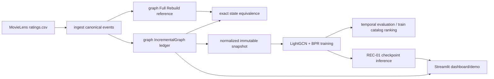

# Kiến trúc v2 hiện hành

`src/ingest/d02_profile.py` canonicalize theo `(event_ts,user_raw_id,movie_raw_id,source_row_id)` và gán `event_id` tăng liên tục. `src/ingest/canonical.py` kiểm schema, ID, domain và thứ tự trong DuckDB. `src/graph/full_builder.py` là reference; `incremental.py` dùng transaction, unique edges, stable registry IDs, degree state và batch ledger. `equivalence.py` so toàn bộ logical rows. `preparation.py` chuẩn bị graph chỉ từ train events. `normalize.py` tạo `D^-1/2 A D^-1/2`; `snapshot.py` materialize/export snapshot version và hash.

`src/models/lightgcn.py` giữ phép lan truyền 3 lớp/mean với embedding ban đầu và BPR loss. `models/training.py` có deterministic triple sampler và BPR optimizer step dùng chung. `models/rec01_train.py` là runner protocol **lịch sử**; `rec01_inference.py` nạp artifact sealed và xếp hạng train catalog. `evaluation/temporal.py`, `rec01.py`, `baselines.py` giữ split/cohort/mask/Recall/NDCG/Popularity. `benchmarking/exp01.py` đo RQ1; `exp02.py` đo snapshot cadence; `gpu_feasibility.py` chứa probe workload T4. Streamlit ở `src/app`; feedback branch cập nhật graph nhưng vẫn giữ checkpoint cũ.

Version `v` là canonical graph sau một batch; `g` là immutable normalized snapshot version; checkpoint `c` ghi graph/config đã dùng. `p` (propagated embeddings version) là contract **thiết kế cho GOAL 04**, chưa có artifact v2. `g` có thể chậm hơn `v`, nhưng snapshot không được gắn nhãn version cũ cho graph mới. REC-01 mask chỉ dùng train events. V2 dùng rolling observed-positive history trước boundary và fixed warm-node policy đã được Owner duyệt.

`src/artifacts.py` cung cấp SHA-256 file bytes, tách khỏi graph builder. Historical probes và DXX/SXX runners vẫn là entrypoints để tái hiện kết quả; core không import chúng. [Audit và dependency graph](../archive/legacy-reports/goal035-audit-plan.md) ghi before và target; [walkthrough](architecture-walkthrough-vi.md) giải thích bằng ví dụ.

GOAL 04 Phase A thêm CPU-only `scripts/goal04_protocol_profile.py` để đo monthly coverage. Owner đã duyệt protocol có điều kiện; [protocol hiện hành](experiment-protocol.md) tách offline quality và serving-like workload, chốt ba repetitions có bao gồm primary quality run và ghi C0-selection bias.

Phase B thêm `src/graph/model_replay.py`: approved cohort + immutable full canonical Parquet → fixed-ID model projection trong DuckDB → versioned normalized Parquet snapshot. `ModelGraphReplay.create` đối chiếu exact base projection với cohort, `advance(boundary)` cập nhật transaction theo `< boundary`; `state` trả contract registry/edges/degrees hiện có. `export_snapshot` và `load_projection_snapshot` kiểm source/mapping/version/boundary/hash và normalization. Canonical event watermark tiến cả khi events ngoài cohort; `canonical_graph_version=null` vì không materialize full graph. Model projection version là namespace riêng, không sửa `IncrementalGraph` hoặc sealed snapshot API.

Phase C2 (toy/local CPU only) thêm `src/evaluation/c0_validation.py` để tạo 12 half-open windows năm 2020, rolling observed-positive mask, fixed catalog và macro Recall@20/NDCG@20; có thể chia windows giữa workers rồi merge chỉ khi đủ và không trùng. `src/models/c0.py` dùng lại `LightGCN`, `bpr_step`, `sample_batches`, `score_chunks`, `evaluate_topk` và `select_checkpoint` cho một trajectory, checkpoint tại 0/500/1500/3000/5000. Checkpoint có schema, config, step và provenance/hashes; strict loader từ chối file/mapping/graph/tensor không tương thích. `load_g0` chỉ nạp snapshot projection version 0, cutoff 2020. Chưa có Kaggle integration hoặc C0 thật; Phase C3 phải chờ nghiệm thu, phê duyệt input upload và tuân thủ GPU budget.

Input canonical phải chứa trọn prefix từ event ID 0 và mọi timestamp ties; không truyền filtered cohort events vào như canonical source. Snapshot schema `fixed_cohort_projection_v1` không thay thế schema historical. Core tái sử dụng canonical validation, file/checksum helpers và normalization; không import experiment runners. [Báo cáo Phase B](../research/goal04-phase-b.md) có API và toy evidence. C3 đóng gói core source vào private Kaggle kernel, tìm inputs theo mounted path rồi xác minh SHA-256; [Kaggle real-5M preflight](../research/goal04-phase-c3.md) đã PASS. C4 runner reuse `load_g0`, `LightGCN`, BPR sampler/step và strict candidate checkpoint loader; [Kaggle C4 version 4](../research/goal04-phase-c4.md) tạo đủ năm candidates và strict reload PASS. Chưa có C0 v2 đã chọn, propagated-cache artifact hay S0/S1 engine; dừng trước C5.

C5 dùng `kaggle_c5_runner.py` và batched exact Top-20 trong `c0_validation.py`: strict load C4/G0, 12 windows 2020, một G0 propagation mỗi candidate, copy immutable embeddings sang T4 thứ hai để chia windows 1–6/7–12; numerical gate quyết định dual-GPU hoặc single-GPU fallback. [Kaggle C5 v2](../research/goal04-phase-c5-preparation.md) đã xuất đủ 60 validation records và không tự chọn C0. C6 dùng `scripts/finalize_goal04_c0.py` tái kiểm raw matrix/comparison và gọi `select_checkpoint`; [selection manifest](../../results/goal04_training/selection.json) tham chiếu nguyên checkpoint C4 step 1500 sau strict reload/hash verification. Không tạo P0 hoặc thay đổi C4 tensors; [Phase C report](../research/goal04-phase-c.md) ghi data flow, APIs và giới hạn. Phase D/E chưa được phép.
