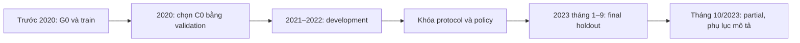

# Protocol nghiên cứu v2

Input là MovieLens 32M, positive `rating >= 4.0`, cumulative graph; base `< 1577836800`, replay `>= 1577836800`. Giữ `source_row_id` để break timestamp ties, không cho future labels hoặc candidate catalog lọt vào train graph. Cùng event watermark mới được so Full Rebuild với Incremental.

RQ1 so exact registry, edge rows, degrees trước khi so chi phí. EXP-01 đo Full Rebuild và Incremental theo output contract giống nhau; validation chạy **ngoài** timer. History prebuild, cache policy, environment, event counts và bytes phải được ghi để tránh diễn giải sai throughput. Snapshot cadence đo tại common versions, so normalized COO trong tolerance. Các số đo lịch sử và raw CSV ở [experiment log](../research/experiment-log.md) và [research index](../research/README.md), không phải kết quả model freshness v2.

RQ2 trong GOAL 04 cần fixed temporal train/validation/test, một cohort và train catalog chung, checkpoint selection chỉ từ validation, test sau khi đã khóa lựa chọn. Ghi riêng canonical version `v`, model graph `g`, checkpoint `c`, propagated embeddings `p`, cutoff, seed, candidates, coverage, hardware, Git commit, source/config hashes và status. Cold/omitted users/movies phải được tính rõ; không suy chất lượng từ resource probe.

REC-01 1M là protocol lịch sử có [kết quả](../research/s04-rec01-results.md) và [sealed bundle](../s12-reproducibility.md). Không thay cutoffs, metrics hoặc checkpoint đã chọn để ép khớp protocol v2. Raw [experiment log](../research/experiment-log.md) giữ các measured observations nguyên bản.

## GOAL 04 — protocol Phase A đã duyệt có điều kiện

Ngày 23/11/2026; baseline HEAD `1745739744f6f4aae0d97ddf83d03a7a80eacbb9`, branch `develop/v2`.
**Owner đã nghiệm thu Phase B và phê duyệt Phase C có điều kiện trong chat/file mục tiêu ngày 23/11/2026.** Phase C chỉ được chạy sau real-5M preflight PASS: canonical provenance, base và monthly projection/snapshot export–reload, hashes/normalization và actual CPU/DuckDB/spill/time/disk. Một trajectory seed 7, steps 0/500/1500/3000/5000, tối đa 5.000 optimizer steps, 1 giờ optimizer và 4 giờ end-to-end được phép sau gate này. Không thêm GPU pilot. Nếu thiếu evaluation của bất kỳ candidate nào thì INCOMPLETE, không chọn C0. Phase D/E vẫn chưa được phép. Raw/full canonical không được upload; loại derived artifact mới cần approval riêng. Phần này là nguồn duy nhất của protocol RQ2; không cấp ngân sách fine-tuning.

### 1. Câu hỏi và giả thuyết có thể bác bỏ

Checkpoint C0 là bộ tham số đã học được lưu lại. Propagation là tính vector biểu diễn bằng cách truyền thông tin qua các cạnh graph; nó không đồng nghĩa với optimizer cập nhật tham số. Staleness là độ trễ giữa lịch sử đã quan sát và lịch sử mà snapshot/vector hiện tại phản ánh.

| Giả thuyết | Phép kiểm đã định trước | Điều gì không hỗ trợ giả thuyết |
| --- | --- | --- |
| H1: khi graph tăng trưởng, stale có thể kém S1 | So paired `S1−S0` Recall@20 và NDCG@20 từng window; mô tả delta theo số cạnh mới và tuổi propagation | Delta không dương, hoặc đảo chiều theo window; không suy nhân quả từ tương quan thời gian |
| H2: propagation-only có thể cải thiện quality với C0 cố định | Delta cùng users/labels/mask; hash parameters không đổi, optimizer calls = 0 | Không cải thiện, hoặc có thay đổi parameters thì phép thử không hợp lệ |
| H3: có đánh đổi quality/compute hữu ích | Báo delta quality, chi phí refresh tăng thêm và Pareto theo window | Tốn thêm compute mà không cải thiện; tỷ lệ gain/time không xác định nếu mẫu số <=0 |

H1–H3 chưa phải kết quả. Báo hai metrics đồng thời; chỉ mô tả “cải thiện cả hai” khi cả hai delta dương. Không chọn metric sau khi nhìn kết quả, không tuyên bố S1 luôn tốt hơn.

### 2. Timeline và lựa chọn checkpoint

- Base G0: `event_ts < 1577836800`. Không train trên events 2020, kể cả sau khi chọn C0.
- Validation: `[1577836800,1609459200)` (2020). Đề xuất checkpoints ở steps **0, 500, 1500, 3000, 5000**, seed 7, 64d/3 layers, batch 1024, Adam LR 0.001, loss BPR hiện hành. Step 0 là đối chứng chưa học. Không thêm hyperparameter search.
- Mỗi checkpoint được propagation trên G0; validation dùng cache đó ở cả 12 monthly windows, cùng observed-history mask tại từng boundary. Chọn macro-window NDCG@20 cao nhất, tie theo Recall@20 rồi step nhỏ nhất (`evaluation/checkpoint_selection.py`). Tất cả eligible users đều được dùng, không chọn subset theo quality. Labels 2020 chỉ dùng lựa chọn, **không công bố như independent test**.
- Development: `[1609459200,1672531200)` (2021–2022), 24 windows. C0 cố định; không dùng development để thay C0. Primary schedule đề xuất monthly cố định, không search; mọi schedule bổ sung phải đăng ký trước holdout và chỉ chọn trên development.
- Final primary holdout: `[1672531200,1696118400)` (01/01–01/10/2023 UTC), 9 tháng đầy đủ. Tháng 10 partial được giữ riêng, không gộp macro primary. Dữ liệu kết thúc `2023-10-13T02:29:07Z`; end-exclusive partial là giây kế tiếp. Không giả định có tháng 11–12.
- Tại đầu tháng `b`: replay **mọi** event `< b`, freeze graph, materialize snapshot nếu cần, generate recommendations, rồi mới đánh giá labels `[b,e)`. Sau `e` mới replay window đó. Event đúng `b` thuộc labels/replay kế tiếp, không thuộc graph tại `b`; không tách nhóm timestamp ties ở evaluation boundary. Canonical order `(event_ts,user_raw_id,movie_raw_id,source_row_id)` không đổi.
- P0 của C0 chỉ dùng G0 dù C0 được chọn cuối 2020. Boundary 01/01/2021 của S1 phải bao gồm mọi events 2020 hợp lệ trong model projection. Không reset graph tại 2023; mang lịch sử 2021–2022 sang holdout nhưng không mang future labels vào snapshot.

Historical validation trước 2020 không được dùng: cohort đã chọn bằng toàn history pre-2020 nên có retrospective selection bias nếu giả vờ cohort biết từ đầu validation đó. Full replay coverage đã được xem trong GOAL 03: holdout chỉ độc lập về **quality chưa được xem**, không hoàn toàn mù về support/cohort design; phải nêu hạn chế này trong báo cáo.

### 3. Cohort, labels, mẫu số và candidates

Canonical graph tiếp tục nhận node mới. Model graph là projection fixed **49.587 users + 40.666 movies**, **4.999.981 base edges**, giữ nguyên `nodes.parquet` và IDs từ [manifest](../../results/model_cohort_v2_manifest.json). Chỉ thêm unique positive edge khi cả hai endpoints thuộc cohort. Không thêm embedding cold node; rating thấp không xóa cạnh. Canonical IDs không được index trực tiếp vào model vectors.

Candidate universe là tập phim được phép xếp hạng: đúng 40.666 movies trong base cohort, giữ cố định mọi window và mọi strategy. Tại `b`, mask tất cả positive pairs đã thấy `< b` (kể cả positives từ các validation/development windows đã kết thúc), không mask rating thấp. Relevant labels là unique positive pairs trong `[b,e)` còn thuộc catalog và chưa positive trước `b`. Dedup nội bộ window trước khi tính Recall. Không có labels hợp lệ thì loại user khỏi metric, không gán Recall=0. Nếu còn dưới 20 candidates thì trả tất cả; có relevant label hợp lệ bảo đảm ít nhất một candidate chưa seen. Báo số users không có candidates riêng khi triển khai.

Phân hoạch **pairs**, theo đúng thứ tự sau; tổng sáu nhóm bằng số unique positive pairs/window:

1. User ngoài model và không thuộc **base positive graph**: base-cold user.
2. User ngoài model nhưng thuộc base positive graph: omitted user.
3. Sau lọc user, movie ngoài catalog và không thuộc base positive graph: base-cold movie.
4. Sau lọc user, movie ngoài catalog nhưng thuộc base positive graph: omitted movie.
5. Cả hai trong cohort nhưng pair positive `< b`: seen pair.
6. Còn lại: eligible labels; distinct users/movies của nhóm này là evaluable warm users/movies.

“Cold” ở đây cố định theo base 2020, **không** có nghĩa node vẫn chưa tồn tại trong canonical graph tại `b`. Một pair cold cả hai đầu chỉ tính ở nhóm user. Distinct cold entities không cộng được thành pair counts; không cộng distinct users giữa các tháng để suy distinct cả năm.

Warm-positive-pair coverage = nhóm 6 / unique positive pairs toàn window. Warm-user coverage = eligible users / distinct users có positive trong window. Nonpositive events chỉ vào rating-event count. `within_window_repeat_events = positive_events − unique_positive_pairs`; `new_canonical_edges` đếm first positive timestamp trong window trên toàn graph, còn `eligible_pairs` cũng là số new model edges trong window. Trên dữ liệu này repeated/seen = 0 là kết quả đo, không phải giả định thuật toán.

### 4. Strategies và ranking công bằng

| Strategy | Parameters và embeddings | Graph/history dùng tại boundary |
| --- | --- | --- |
| S0 Stale | C0 bất biến; cache P0 = propagation(C0,G0) bất biến; **0 forward, 0 optimizer** sau cache ban đầu | Chỉ observed mask thay đổi; không âm thầm gọi model để ranking |
| S1 Propagation-only | Chính C0; **1 full-graph forward/refresh, 0 optimizer**; inference mode | Updated fixed-cohort projection với events `< b`, normalize lại toàn degree |
| S2 Popularity | Số unique positive selected users/phim trong model projection `< b` | Cùng fixed catalog, eligible users và mask; là reference quality baseline |

Rank chính xác full catalog bằng dot product cho S0/S1, popularity count cho S2; score giảm dần, raw movie ID tăng dần khi tie. K=20. Không sampled negatives cho evaluation. `score_chunks` có thể tái sử dụng để giới hạn RAM. Hash chung eligible-user list, label pairs, candidate list và seen-mask ở mỗi boundary để kiểm fairness. Tách **hai workloads** và báo timer riêng:

- **Offline quality evaluation:** dùng eligible users xác định từ labels sau boundary để tiết kiệm scoring; danh sách này chỉ vào scoring/chấm điểm, không vào graph, propagation hoặc policy. Mọi strategy dùng cùng offline users. Thời gian này là chi phí offline evaluation, không phải serving latency.
- **Serving-like ranking benchmark:** tại mỗi boundary, từ fixed selected users chỉ lấy users có >=1 positive thuộc catalog trong 90 ngày UTC `[b−90×86400,b)` và còn ít nhất 1 candidate chưa seen. Chọn tối đa 1.000 users theo raw user ID tăng dần; không đủ thì lấy tất cả, rỗng thì benchmark `not_applicable`. Không đọc future labels để chọn/filter hoặc xác định số users. Ghi eligible-pool count, selected count và hash raw IDs. Đây là workload hoạt động gần đây có deterministic ID sampling bias, không đại diện toàn traffic.
- S0/S1/S2 dùng cùng benchmark user IDs, catalog, rolling positive mask, K và tie rule. Offline và benchmark có thể trùng user nhưng scoring phải chạy riêng, không reuse ranked output hoặc trộn timers. Benchmark ranking dùng embeddings cache đã được tạo theo schedule, không thêm forward. Không triển khai online serving trong Phase B.

Kiểm C0 parameter hash trước/sau, mapping hash, edge/degree checksum, provenance của P. Nếu graph không đổi: forward FP32 cùng device/dtype phải `allclose(atol=1e-6, rtol=1e-5)`; normalization FP64 theo tolerance hiện có `1e-12`. Ranking tie-break deterministic nhưng gần-tie FP32 khác device có thể đổi thứ tự; ghi environment và không trộn kết quả device.

### 5. Metrics và paired uncertainty

Với user u, relevant set R_u và danh sách top-20 L_u:

- `Recall@20(u) = |R_u ∩ L_u| / |R_u|`: tìm được bao nhiêu phần positive labels của user.
- `DCG@20(u) = Σ[r=1..20] 1[L_u[r]∈R_u] / log2(r+1)`.
- `NDCG@20(u) = DCG / Σ[r=1..min(20,|R_u|)] 1/log2(r+1)`: thưởng hits đứng đầu nhiều hơn, chuẩn hóa theo ranking lý tưởng.

Metric/window là mean trên eligible users, không weighted theo số positives. Primary tổng hợp là mean trên các **full windows** của cùng split, mỗi tháng một trọng số; không trộn validation/development/holdout. Secondary pooled user-window mean phải gắn tên riêng vì một user có thể xuất hiện nhiều tháng. Empty window: metric `null`, báo mẫu số và coverage; không bỏ window âm thầm hoặc thay bằng 0. Low-support vẫn báo descriptive, không loại dựa quality.

Paired delta theo cùng user-window, rồi macro theo window. Đề xuất 2.000 bootstrap replicates seed 7, cluster theo raw user ID trên toàn split (giữ mọi window của user), tính lại cùng macro estimand; 95% percentile CI và n distinct users, n user-windows, n windows. Không bootstrap hai strategies độc lập. CI conditional trên C0/seed này, không đo biến thiên training seed hay temporal shock; với <100 distinct users hoặc <6 full windows chỉ descriptive, không claim significance. Hai metrics và nhiều windows tạo multiplicity: không chọn riêng window có lợi để kết luận. Báo window dispersion; không coi 24 tháng là 24 training repetitions độc lập.

### 6. Support và budget đề xuất

Minimum support được ghi **trước khi chạy monthly audit**: >=100 eligible users và >=500 labels/window. Monthly khả thi nếu >=80% full development months đạt cả hai; nếu không, đề xuất quarter calendar và phải đo lại support theo quarter (không cộng distinct users/month). Không chọn granularity dựa holdout quality; holdout chỉ kiểm aggregate support và giữ fixed primary windows.

Ngân sách C0 dưới đây **đã được duyệt có điều kiện real-5M preflight PASS**; ngân sách D/E vẫn là kế hoạch chưa được phép chạy, không phải dự báo latency. Primary quality run **là repetition 1 trong tổng 3**, không có run thứ tư:

| Hạng mục | Đề xuất giới hạn |
| --- | --- |
| C0 selection | 1 seed=7, <=5.000 optimizer steps, <=1 giờ optimizer, <=4 giờ toàn train/validation/artifacts; gặp cap trước đủ checkpoints thì báo incomplete, không chọn trên tập bị cắt |
| S1 refresh | Monthly tại đầu mỗi window chính 2021–09/2023: 33 forward cho một run, 0 optimizer; mỗi forward <=60 s |
| Graph/snapshot setup | <=300 s/boundary; gồm replay/projection, normalize/materialize và transfer, đo riêng từng phần |
| Ranking/evaluation | Offline quality <=900 s/strategy/window ở repetition 1; serving-like ranking <=300 s/strategy/window ở cả 3 repetitions. Timeout là incomplete, không tự giảm users/catalog |
| Resource | Một Kaggle T4 `cuda:0`, CPU effective available >=2 GiB, GPU effective free/headroom >=30%; stop tại OOM/vi phạm |
| Repetition | Rep 1: quality + serving-like benchmark; reps 2–3: serving-like cost only, không quality scoring/bootstrap lại. Cùng C0/input, isolated fresh replay state; ranking order S0/S1/S2, S1/S2/S0, S2/S0/S1 tương ứng. Tổng 3 runs <=30 giờ end-to-end; không run bổ sung |

Không warm-up forward cho S0 sau P0. Cache filesystem/process state ghi rõ; cold start/load và warm cache cost tách riêng. October chỉ giữ counts descriptive trong budget hiện tại, **không chạy October quality/refresh**. Tổng Phase D/E: 33 boundaries × 3 reps = **99 S1 forwards**; **1 P0 forward** tạo một lần, hash/reload cho cả 3 reps; **0 S0 forwards sau P0**, **0 S2 forwards**, **0 optimizer steps**. Tổng tối đa **100 full-graph forwards** sau khi C0 đã được chọn, gồm P0. Load P0 mỗi repetition tính vào setup, không tạo lại. Không warm-up/retry forward ngoài 100 calls; lỗi/timeout dừng, lần gọi thất bại vẫn tiêu budget.

Budget C0 (Phase C, tách khỏi 100 calls): <=5.000 optimizer forwards/backwards + 5 validation-cache forwards (steps 0/500/1500/3000/5000), tổng <=5.005 forward calls, <=4 giờ end-to-end gồm <=1 giờ optimizer. Mỗi checkpoint cache dùng lại cho 12 validation windows. Primary P0 được tạo riêng sau chọn C0 và đã tính trong 100 calls, không suy ngầm từ feasibility checkpoint. Tổng kế hoạch C–E <=34 giờ, <=5.105 forwards, chỉ sau approval chạy thực tế. Checks replay/normalization Phase B không gọi LightGCN.

Đo/báo **serving-like ranking seconds** riêng (không gồm refresh/quality); **serving-like end-to-end/boundary** gồm input validation/load, replay, normalization/materialization/transfer khi strategy cần, cache load và benchmark ranking. Chi phí shared báo riêng và charged total, không chia tùy ý để làm S1 rẻ hơn. **Offline quality seconds** gồm offline rank + metrics riêng; bootstrap một lần/split ở rep 1 đo riêng. **Run elapsed** là wall-clock toàn process gồm setup, hash/invariants, artifact I/O, quality nếu có, cost benchmark, cleanup; tổng elapsed của cả 3 runs tính vào 30 giờ, không loại phần offline khỏi budget. Báo elapsed từng rep vì rep 1 có thêm quality; chỉ lấy median/min/max qua 3 reps cho các pha serving-like có cùng measurement boundaries. Không lấy mean của 3 whole-run elapsed làm serving cost. Chạy nối tiếp một T4; không chồng timers GPU để tiết kiệm budget.

[Evidence T4](../research/gpu-feasibility-v2.md): 5M setup khoảng 36 s, forward riêng khoảng 0,10–0,34 s; 500 optimizer steps 184,91 s, peak RSS 3,43 GiB, reserved 1.124 MiB. Đây là feasibility probes, không phải cam kết runtime 5.000 steps hay full-user ranking. Model graph tối đa thêm số eligible future pairs trong counts audit; không ngoại suy VRAM tuyến tính.

Timer `perf_counter`, CUDA synchronize trước/sau GPU pha; peak allocated/reserved reset từng pha, CPU RSS/available RAM sampling 10ms (có thể bỏ sót transient), artifacts/checkpoint bytes. Ghi graph-update, normalize, export/load/transfer, forward, ranking, metric và end-to-end riêng. Shared graph setup/mask cost báo riêng cùng full charged total cho từng strategy; incremental S1 cost không che chi phí chung. Staleness báo event-watermark lag, model-edge lag, thời gian từ boundary snapshot và propagation tương ứng; không trừ hai version numbers khác namespace.

### 7. Contract manifest dự kiến và reuse audit

Experiment manifest đề xuất (chưa có runtime engine):

| Nhóm | Trường bắt buộc |
| --- | --- |
| Identity | schema_version, run_id, status/error, Git commit + dirty diff/source hashes, protocol SHA-256, approval reference, environment, seed/device/dtype |
| Inputs | source SHA-256, cohort manifest/hash, fixed mapping hash, catalog hash, C0 config/state hash, selected step, validation record hash |
| Temporal | split, window UTC start/end-exclusive, partial flag, canonical event watermark + last canonical tuple; canonical graph version nullable nếu không materialize full graph |
| Graph | projection_version, edge/degree hashes/counts, observed cutoff, normalized snapshot ID/hash, normalization policy/dtype/tolerance |
| Propagation | artifact ID/hash, checkpoint hash, snapshot hash, mapping hash, layers/dim, created UTC, event watermark, seed/device/dtype, parameter-before/after hashes, forward/optimizer call counts |
| Evaluation | strategy, K/tie rule, eligible users hash/count, labels hash/count, mask hash, catalog hash/count, exclusions/denominators, per-user/window metrics, aggregate method |
| Resources | phase wall times, CPU peak/available, GPU allocated/reserved/free, artifact bytes, cache policy, repetition index, execution status |

`v` canonical, model projection version, `g` normalized snapshot, `c` checkpoint và `p` propagated cache là các namespace khác nhau. Không gán synthetic full-graph version khi chỉ projection được materialize.

- `ingest/canonical.py` và `replay.py`: validate và slice canonical IDs; giữ tie order. Counts audit không tạo canonical stream, chỉ aggregate raw CSV với source hash đã xác minh.
- `graph/incremental.py`: canonical registry đăng ký theo first event và yêu cầu contiguous event IDs. **Không truyền filtered projection stream vào API này như canonical stream**; Phase B cần explicit projection contract/mapping, không đổi semantics core.
- `graph/normalize.py`: dùng lại exact degrees và symmetric normalization. `snapshot.py` hiện gắn snapshot với canonical version/registry; cần adapter rõ projection namespace sau approval, không giả là đã hỗ trợ fixed cohort.
- `graph/preparation.py`: train-only prefix có ích nhưng full-reference path không tự dùng làm 5M projection. Không cần materialize toàn graph 13,64M mỗi boundary.
- `models/lightgcn.py`, `training.py`: propagation và BPR đã có; feasibility runner **có optimizer**, không dùng như S1 runner.
- `evaluation/temporal.py`: reuse rank/metrics; `split_events` lịch sử dùng `<=` nên không dùng trực tiếp cho `[b,e)` v2; `cutoff_cohort` chưa tách cold/omitted hoặc rolling-history exclusions. `baselines.py` reuse với model projection state và cùng mapping/catalog; `model_cohort.py` sở hữu approved selection, không chọn lại cohort.

### 8. Leakage audit và stop conditions

| Rủi ro | Kiểm soát bắt buộc |
| --- | --- |
| Future edge/degree trong snapshot | Assert mọi first event `< b`, đối chiếu independent toy/full reference, events đúng b ở window sau |
| Checkpoint/cohort/policy selection đọc holdout | C0 chỉ validation 2020; fixed cohort hash; holdout quality đóng đến approval + policy freeze; Phase A chỉ counts |
| Stale được forward lại | Immutable P0 hash, instrument call count=0; observed mask chung vẫn được cập nhật |
| Cold nodes/candidate catalog mở rộng | Fixed mapping/hash; reject mismatched checkpoint, snapshot, P; không tạo embedding mới |
| Hai strategy dùng labels/mask khác nhau | Hash common evaluation bundle; compare same users/candidates/labels/mask |
| Historical code giả định boundary khác | Test timestamp equality/ties; không sửa sealed REC-01 protocol |
| Nhìn holdout rồi sửa bug/policy | Ghi incident, ảnh hưởng independence; dừng để Owner review trước rerun |
| Coverage thấp/chọn user-recency gây bias | Báo denominators mỗi window, kết luận giới hạn warm cohort, không suy toàn MovieLens 32M |

Phase B–E phải có tests cho idempotency/dedup, degrees/normalization/fixed mapping, leakage/ties, independent projection equivalence, artifact mismatch/version consistency, C0/P0 immutability, S1 zero optimizer, checkpoint save/reload, fairness và toy end-to-end; cuối mỗi phase full regression. Phase A chỉ kiểm coverage; không giả có các engine tests này rồi.

### 9. Quyết định cần Owner duyệt và giải thích học tập

Owner đã duyệt các quyết định nghiên cứu: (1) timeline 2020 selection, 2021–2022 development, Jan–Sep 2023 primary và October descriptive; (2) fixed cohort/catalog, rolling positive mask, ordered exclusions và S2 projection-popularity; (3) monthly schedule/support rule, metrics/aggregation/paired CI; (4) C0 checkpoints, ngân sách T4 và repetitions nêu trên. Hai điều kiện bổ sung đã được đáp ứng bằng tách workload và budget accounting tại mục 4/6. Phase B đã được nghiệm thu; Phase C được phép sau real-5M preflight PASS theo approval mới. Dừng trước Phase D. Không coi việc chưa phản hồi là approval. Nếu hết budget hay quality validation thấp, báo blocker; không tự tăng steps, đổi cohort hoặc mở holdout để tìm cách cải thiện.

Mục tiêu Phase A là định nghĩa phép so công bằng trước khi viết engine. Ví dụ user A đã positive phim X trước boundary, sau boundary positive Y: che X cho cả S0/S1; Y chỉ là đáp án, chưa phải cạnh để dự đoán window này. Khi window kết thúc, Y mới thêm vào graph; S1 propagation dùng cạnh Y ở boundary kế tiếp, S0 vẫn P0 nhưng cũng che Y. Với 2 relevant phim và tìm được 1 trong top-20, Recall=1/2; NDCG cao hơn nếu hit ở vị trí 1 thay vì 20.

Input Phase A: raw ratings chỉ đọc, approved cohort Parquet/manifest. `scripts/goal04_protocol_profile.py` dùng DuckDB và constants/hash từ module hiện có; output là [monthly counts](../../results/goal04_protocol/monthly.csv) và [provenance](../../results/goal04_protocol/manifest.json). Đây là coverage, **không phải Recall/NDCG**. Code này không cập nhật graph hay tạo embeddings. Cách đọc: xem mẫu số, exclusions, eligible users, distribution labels trước khi diễn giải support; sau approval mới có quality/cost để kiểm H1–H3.

Ba câu tự kiểm tra: (1) Vì sao label đúng timestamp boundary chưa được đưa vào graph? (2) Vì sao S0 được cập nhật seen-mask nhưng không được propagation lại? (3) Vì sao 11,73% pair coverage không phải Recall@20 và không đại diện chất lượng toàn dataset?

### 10. Kết quả support thực đo (counts-only)

46 windows đã kiểm tra; 24/24 development months đạt ngưỡng, vì vậy monthly đã được Owner duyệt. Source/graph hashes khớp approved manifest. Cả 46 tháng khớp rating events, positive events và new canonical edges của temporal profile trước đó. Sáu nhóm exclusions toàn replay khớp cohort manifest: 1.948.688 cold-user + 23.556 omitted-user + 52.049 cold-movie + 84 omitted-movie + 0 seen + 268.965 eligible = 2.293.342 pairs.

Bảng dưới rút gọn để review; [CSV đầy đủ](../../results/goal04_protocol/monthly.csv) chứa exact epoch boundaries, canonical rating events, new unique edges, cold/omitted/seen pairs, repeat events, eligible movies và phân phối labels min/median/p90/max/mean. Mỗi boundary là 00:00 UTC ngày 1 của tháng; end-exclusive là ngày 1 tháng sau, riêng October là `1697164148` (13/10/2023 02:29:08 UTC).

| Window | Rating events | New canonical edges | Eligible users | Eligible movies | Labels | Pair coverage | Labels median / p90 |
| --- | ---: | ---: | ---: | ---: | ---: | ---: | ---: |
| 2020-01 | 125,929 | 65,769 | 2,059 | 4,855 | 14,882 | 22.63% | 3 / 14 |
| 2020-02 | 101,901 | 50,044 | 1,803 | 3,793 | 11,158 | 22.30% | 3 / 13 |
| 2020-03 | 147,415 | 74,302 | 1,848 | 4,682 | 13,693 | 18.43% | 3 / 15 |
| 2020-04 | 196,780 | 101,222 | 1,911 | 4,382 | 14,126 | 13.96% | 3 / 16 |
| 2020-05 | 179,170 | 93,963 | 1,739 | 4,226 | 12,508 | 13.31% | 3 / 15 |
| 2020-06 | 127,165 | 65,133 | 1,472 | 3,653 | 9,942 | 15.26% | 3 / 13 |
| 2020-07 | 137,284 | 67,917 | 1,441 | 3,446 | 8,896 | 13.10% | 3 / 12 |
| 2020-08 | 140,801 | 71,707 | 1,422 | 3,866 | 10,685 | 14.90% | 3 / 13 |
| 2020-09 | 124,030 | 64,457 | 1,331 | 3,193 | 7,696 | 11.94% | 2 / 11 |
| 2020-10 | 137,357 | 67,957 | 1,309 | 3,587 | 7,816 | 11.50% | 2 / 12 |
| 2020-11 | 137,105 | 70,665 | 1,302 | 3,519 | 8,434 | 11.94% | 2 / 12 |
| 2020-12 | 133,222 | 70,969 | 1,344 | 3,663 | 8,184 | 11.53% | 3 / 11 |
| 2021-01 | 151,055 | 76,409 | 1,361 | 3,462 | 8,191 | 10.72% | 2 / 12 |
| 2021-02 | 131,295 | 65,783 | 1,239 | 3,396 | 7,767 | 11.81% | 2 / 11 |
| 2021-03 | 123,259 | 59,274 | 1,162 | 2,937 | 5,937 | 10.02% | 2 / 11 |
| 2021-04 | 117,140 | 58,336 | 1,138 | 2,917 | 6,057 | 10.38% | 2 / 10 |
| 2021-05 | 104,979 | 53,005 | 1,084 | 2,753 | 5,496 | 10.37% | 2 / 10 |
| 2021-06 | 92,078 | 47,849 | 933 | 2,662 | 4,624 | 9.66% | 2 / 11 |
| 2021-07 | 99,408 | 49,232 | 981 | 2,846 | 5,217 | 10.60% | 2 / 10 |
| 2021-08 | 100,589 | 51,799 | 992 | 2,841 | 5,498 | 10.61% | 2 / 11 |
| 2021-09 | 87,140 | 42,174 | 909 | 2,614 | 4,912 | 11.65% | 2 / 9.2 |
| 2021-10 | 72,193 | 33,262 | 871 | 2,324 | 3,941 | 11.85% | 2 / 9 |
| 2021-11 | 73,419 | 35,491 | 882 | 2,383 | 3,857 | 10.87% | 2 / 8 |
| 2021-12 | 87,357 | 42,320 | 911 | 2,949 | 5,273 | 12.46% | 2 / 10 |
| 2022-01 | 105,045 | 47,558 | 929 | 2,637 | 4,705 | 9.89% | 2 / 9 |
| 2022-02 | 89,586 | 39,836 | 827 | 2,860 | 4,681 | 11.75% | 2 / 8 |
| 2022-03 | 73,954 | 33,931 | 772 | 2,218 | 3,575 | 10.54% | 2 / 9 |
| 2022-04 | 78,431 | 37,751 | 792 | 2,295 | 3,770 | 9.99% | 2 / 10 |
| 2022-05 | 64,867 | 30,788 | 756 | 2,184 | 3,596 | 11.68% | 2 / 9 |
| 2022-06 | 70,348 | 33,533 | 706 | 2,010 | 3,359 | 10.02% | 2 / 8 |
| 2022-07 | 62,898 | 30,021 | 724 | 1,981 | 3,314 | 11.04% | 2 / 8 |
| 2022-08 | 80,105 | 37,690 | 727 | 2,439 | 3,934 | 10.44% | 2 / 9 |
| 2022-09 | 68,369 | 31,802 | 647 | 1,709 | 2,733 | 8.59% | 2 / 8 |
| 2022-10 | 63,799 | 30,014 | 706 | 2,315 | 3,637 | 12.12% | 2 / 9 |
| 2022-11 | 74,303 | 35,350 | 690 | 1,932 | 3,035 | 8.59% | 2 / 8 |
| 2022-12 | 81,400 | 38,845 | 777 | 2,911 | 5,163 | 13.29% | 2 / 9 |
| 2023-01 | 100,992 | 49,958 | 806 | 2,347 | 4,286 | 8.58% | 2 / 10 |
| 2023-02 | 76,015 | 39,792 | 706 | 1,943 | 2,896 | 7.28% | 2 / 8 |
| 2023-03 | 80,679 | 38,593 | 678 | 2,102 | 3,125 | 8.10% | 2 / 8 |
| 2023-04 | 76,535 | 35,922 | 680 | 2,147 | 3,207 | 8.93% | 2 / 8 |
| 2023-05 | 77,421 | 36,607 | 624 | 1,642 | 2,346 | 6.41% | 2 / 7.7 |
| 2023-06 | 67,301 | 31,333 | 593 | 1,668 | 2,418 | 7.72% | 2 / 8 |
| 2023-07 | 90,409 | 44,126 | 689 | 2,389 | 3,702 | 8.39% | 2 / 9 |
| 2023-08 | 96,315 | 48,996 | 655 | 1,756 | 2,741 | 5.59% | 2 / 8.6 |
| 2023-09 | 94,583 | 46,298 | 638 | 2,079 | 3,083 | 6.66% | 2 / 9 |
| 2023-10 (partial) | 33,804 | 15,559 | 304 | 757 | 869 | 5.59% | 1 / 6 |

Development ít nhất 647 eligible users và 2.733 labels/tháng. Holdout full months ít nhất 593 users và 2.346 labels; pair coverage chỉ 5,59–8,93%. October partial có 304 users, 869 labels, không đưa vào primary mean. Coverage thấp là giới hạn quần thể, không phải bằng chứng quality thấp/cao.

Tái lập CPU audit (output phải mới): `..\venv\Scripts\python.exe -m scripts.goal04_protocol_profile --source ..\ml-32m\ratings.csv --cohort results\model_cohort_v2_final\edges_5000000 --out results\goal04_protocol_repro`. Toy boundary/dedup/exclusion test: `..\venv\Scripts\python.exe -m unittest tests.test_goal04_protocol_profile -v`.

**Limitation về checkpoint selection:** C0 được chọn trên stale-G0 validation, nên tiêu chí lựa chọn ưu tiên checkpoint có chất lượng tốt khi giữ G0; nó có thể tạo selection bias khi so với S1. Không chọn lại C0 theo S1/holdout trong primary experiment và không diễn giải kết quả là bằng chứng một phương pháp luôn vượt trội.
