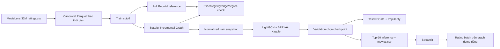
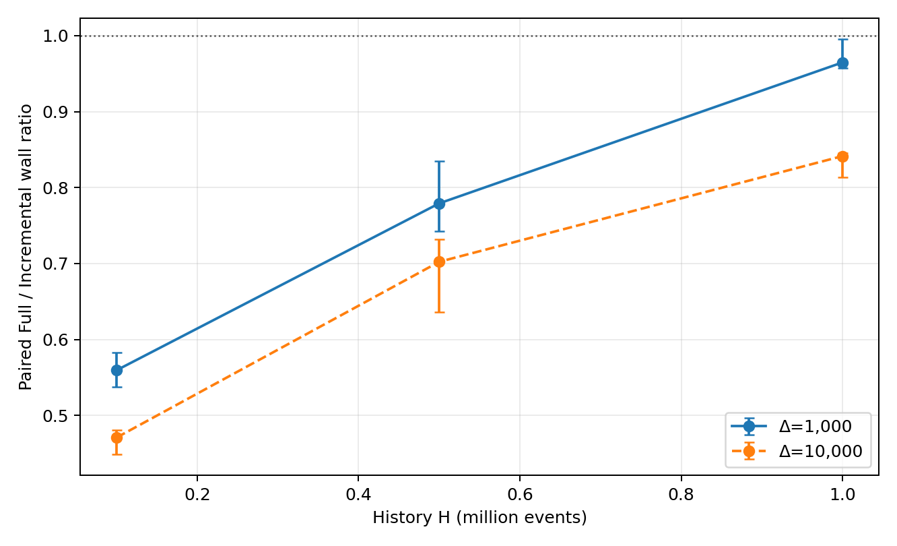

# Xây dựng hệ thống gợi ý phim cá nhân hóa sử dụng LightGCN kết hợp pipeline xử lý dữ liệu lớn và cập nhật đồ thị tăng dần

**Bản báo cáo kỹ thuật S12 — 21/11/2026**  
**Học phần:** Introduction to Big Data  
**Sinh viên, giảng viên, lớp và yêu cầu định dạng:** cần Project Owner điền theo mẫu chính thức.  
**Phạm vi kết quả:** MovieLens 32M là nguồn dữ liệu; model REC-01 dùng canonical prefix 1M, benchmark Engineering dùng prefix đến 2M. Không có phép train/evaluation LightGCN trên toàn bộ 32M.

## Tóm tắt

Đề tài xây dựng pipeline từ ratings lịch sử của MovieLens 32M đến đồ thị hai phía user–movie, trạng thái cập nhật tăng dần, normalized sparse adjacency, mô hình LightGCN và ứng dụng Streamlit. Dữ liệu gốc có 32.000.204 ratings theo [GroupLens](https://files.grouplens.org/datasets/movielens/ml-32m-README.html) và đã được kiểm tra MD5 cục bộ. Giao thức REC-01 trên canonical prefix 1M chia thời gian thành train/validation/test, train LightGCN bằng BPR trên Kaggle Tesla T4, chọn checkpoint theo validation NDCG@20 rồi đánh giá test độc lập. Trên 403 warm users và 773 train movie candidates, LightGCN đạt Recall@20 = 0,128000, NDCG@20 = 0,085161; Popularity đạt 0,128099 và 0,086897. Popularity nhỉnh hơn trong run này.

Về Engineering, Full Rebuild và Incremental Update tạo cùng registry, edges và degrees trong 48 cặp benchmark đã audit. Trong core grid tới history 1M, Full nhanh hơn toàn bộ cặp đo. Run history 2M riêng với delta 1k cho Incremental thắng 5/5 cặp, paired Full/Incremental wall ratio median 1,156; delta 10k gần hòa. Ứng dụng nhận batch rating mới trên bản sao graph, replay idempotent, hiển thị canonical graph version và checkpoint version riêng. Probe 1M+20 feedback so chính xác trạng thái sau cập nhật với Full Rebuild. Kết quả chứng minh correctness và các trade-off trong phạm vi đã đo; không suy ra lợi ích trên graph 32M hoặc model quality sau feedback.

## 1. Giới thiệu và câu hỏi nghiên cứu

Một recommender dựa trên tương tác cần hai vòng đời khác nhau: cập nhật dữ liệu/đồ thị khi xuất hiện rating, và làm mới biểu diễn hoặc tham số mô hình để gợi ý phản ánh dữ liệu đó. Gộp hai việc này vào một nhãn “refresh” sẽ che mất chi phí và độ cũ thực tế. Dự án đặt ba câu hỏi:

1. **RQ1 — Correctness:** Stateful Incremental Update có tạo đúng cùng node registry, binary positive edges và degrees như Full Rebuild ở cùng cutoff và sau replay không?
2. **RQ2 — Chi phí:** Chi phí Full/Incremental thay đổi thế nào theo history `H` và delta `Δ` trong output contract đã chọn? Việc giảm tần suất materialize normalized snapshot đổi chi phí lấy độ cũ bao nhiêu?
3. **RQ3 — Chất lượng gợi ý:** LightGCN đã huấn luyện có tạo Top-20 hợp lệ theo temporal protocol, và kết quả so với Popularity trên cùng warm cohort là gì?

Đóng góp là hệ thống tái lập được gồm canonical data, versioned graph, LightGCN checkpoint, đánh giá offline và giao diện demo; không đề xuất kiến trúc GNN mới hoặc hệ thống streaming production. [Định hướng phạm vi](10-direction-update-v1.md), [bằng chứng claim](09-report-evidence.md).

## 2. Cơ sở lý thuyết

### 2.1. Đồ thị tương tác và chuẩn hóa

Đồ thị hai phía `G=(U∪I,E)` nối user với movie. Theo [DEC-005](06-decisions-and-risks.md), một cặp user–movie tạo một cạnh binary nếu tồn tại rating `>=4,0` trong tập train. Với cạnh `(u,i)`, degree `d_u,d_i` cho trọng số đối xứng `Ã_ui=1/sqrt(d_u*d_i)`. Khi có cạnh mới, degree của các node liên quan tăng nên trọng số trên một số cạnh cũ cũng thay đổi; vì thế canonical edge state và normalized model graph được version riêng. [LightGCN gốc](https://arxiv.org/abs/2002.02126) dùng propagation tuyến tính qua graph và kết hợp embeddings các lớp; implementation dự án dùng sparse PyTorch COO, 3 propagation layers, embedding 64 chiều, không thêm feature transformation hoặc nonlinear activation trong propagation.

### 2.2. BPR và Top-K evaluation

Với positive movie `i` và sampled negative movie `j` cho user `u`, implementation tối thiểu tối ưu `softplus[-(s_ui-s_uj)]` theo mini-batch. Đây là biến thể xếp hạng dựa trên [Bayesian Personalized Ranking](https://proceedings.mlr.press/r7/rendle09a.html); code REC-01 **không** thêm hạng L2 regularization, nên không mô tả nó là toàn bộ objective của bài báo. Recall@20 cho mỗi user bằng số relevant movies xuất hiện trong Top-20 chia số relevant eligible movies. NDCG@20 dùng binary relevance, chiết khấu `1/log2(r+1)`, chuẩn hóa bằng DCG lý tưởng; metric cuối là trung bình theo user. [Giao thức khóa trước run](s01-evaluation-spec.md).

### 2.3. Idempotency và graph freshness

`applied_batches` lưu batch ID, hash payload, event watermark và graph version trong cùng DuckDB transaction với registry, edge và degree. Replay cùng ID/hash trả `NO_OP`; cùng ID nhưng hash khác bị từ chối. Normalized graph có `model_graph_version` của canonical snapshot nguồn, còn checkpoint LightGCN có version gắn với graph được dùng khi train. `canonical_graph_version > model_graph_version` thể hiện độ cũ theo batch, **không** có nghĩa model đã tự học lại. [Thiết kế](03-system-design.md), [D04 ledger](d04-incremental.md), [DEC-018](06-decisions-and-risks.md).

## 3. Dữ liệu và kiến trúc hệ thống

### 3.1. Nguồn và canonical events

[MovieLens 32M](https://grouplens.org/datasets/movielens/32m/) do GroupLens công bố có 32.000.204 ratings, 200.948 users và 87.585 movies trong metadata. File `ratings.csv` gồm `userId,movieId,rating,timestamp`; ratings từ 0,5 đến 5,0 theo nửa sao. Dự án kiểm MD5 `ratings.csv=cf12b74f9ad4b94a011f079e26d4270a` và `movies.csv=0df90835c19151f9d819d0822e190797`, khớp README đi kèm. D02 profile toàn bộ 32M ratings, sau đó sắp xác định theo `timestamp,userId,movieId,source_row_id`, gán event IDs liên tiếp và xuất prefix Parquet. Sử dụng [DuckDB Parquet reader/COPY](https://duckdb.org/docs/data/parquet) cho scan và ghi. `movies.csv` chỉ dùng để bổ sung title/genres **sau** ranking, không là feature của LightGCN. [D02](d02-data-profile.md), [D06 metadata validation](d06-normalization.md).

### 3.2. Luồng xử lý

Canonical graph có `NodeRegistry` (ID node ổn định), `EdgeState` (mỗi positive pair một cạnh), `DegreeState` và batch ledger. Full Rebuild ở cùng prefix làm đối chứng độc lập. Normalized snapshot lưu node map/COO/manifest và hash để LightGCN đọc đúng graph version. REC-01 checkpoint, model IDs, config, cohort report và output manifest được seal; app kiểm hash trước khi inference. Feedback của app vào graph branch riêng, không sửa artifact đánh giá. [D05 exact equivalence](d05-equivalence.md), [S03 artifact](s03-kaggle-workflow.md), [S10 feedback](s10-rating-graph-refresh.md).

## 4. Thiết kế thực nghiệm

### 4.1. REC-01: model quality

Source là canonical prefix 1.000.000 events, SHA-256 `f17048bd7b12bea613387c169c65db6ce67442aa7341314f5e18fba39efcfbae`. Cutoffs ở 80%/90% **distinct timestamps**: `840100781` và `841267862`; train/validation/test gồm `802.988/102.046/94.966` events. Train graph có 14.388 nodes, 392.626 positive edges và 773 candidate movies. Cùng candidate universe, train-seen mask, warm user cohort và future labels được dùng cho LightGCN/Popularity. Cold users/movies ngoài train catalog bị loại và được đếm riêng. LightGCN: seed 7, 64 chiều, 3 layers, batch BPR 1.024, Adam learning rate 0,001, tối đa 500 steps. Chọn checkpoint 100/300/500 theo validation NDCG@20; chỉ sau đó reload checkpoint thắng và tính test. Popularity đếm unique positive train users mỗi movie. [S01 protocol](s01-evaluation-spec.md), [S04 results](s04-rec01-results.md).

Training chính chạy trên [Kaggle Notebook Version 3](https://www.kaggle.com/code/khoakp/rec01-movielens-1m-gpu-validation?scriptVersionId=372012165), GPU Tesla T4 theo report, Python 3.13.16, PyTorch 2.11.0+cu130 và DuckDB 1.5.6. Notebook báo phiên T4 x2; run chỉ ghi một GPU và không được mô tả là multi-GPU training. Output đã tải local, `seal-output PASS` và `verify-output PASS`; config SHA-256 `8b8223681cf181d0ae9bd2b794d0e0f8159b3c01443622fabffff27820b8b8e8`. [S03 workflow](s03-kaggle-workflow.md).

### 4.2. EXP-01: Full so với Incremental

Benchmark CPU trên cùng máy, DuckDB một thread, mỗi case một warm-up và năm measured repetitions/method; thứ tự Full/Incremental shuffle. Cùng input cutoff và output contract: cập nhật/rebuild rồi export toàn bộ registry, edges và degrees. Core grid `H={100k,500k,1M}`, `Δ={1k,10k}`; run H=2M riêng. Incremental prebuild history ngoài timer và ghi riêng. Mỗi cặp phải exact equivalent trước khi dùng latency. Raw gồm wall time, CPU time, RSS lấy mẫu, I/O và output bytes; OS cache không reset được. [D12 protocol/raw](d12-exp01-results.md), [S06 audit](s06-exp01-audit.md).

### 4.3. EXP-02 và S11 integration

EXP-02 dùng prefix 100k, mười batch 10k; `R=1` materialize/export normalized graph sau mọi batch, `R=5` sau v5/v10, ba measured repetitions mỗi chế độ. So exact normalized snapshots ở boundary chung. Đây là chi phí graph normalization/export, **không** là chi phí retrain LightGCN. [D13](d13-exp02-results.md).

S11 là correctness probe riêng trên REC-01 train prefix 1M cộng 20 rating mới. Full Rebuild từ train events + batch được so từng dòng với graph branch incremental; checkpoint/inference giữ nguyên. Timing của một lượt chỉ là chẩn đoán, không đưa vào EXP-01. [S11](s11-integration-scaling.md).

## 5. Kết quả và thảo luận

### 5.1. Correctness

D05 đã so Full/Incremental tại 35 boundaries trên toy/100k và kiểm 70 replay không đổi snapshot. REC-01 Kaggle train graph version 81 có Full/Incremental registry/edges/degrees hashes khớp. S11 trên 802.988 train events + 20 feedback events có registry **14.388**, edges **392.636** và degrees **14.388** khớp từng dòng Full/Incremental. Mười rating 5,0 thêm 10 cạnh; mười rating 2,5 không thêm cạnh. Replay cùng request `NO_OP`; graph version 81→82, model graph version giữ 81. Toàn bộ 60 local tests PASS tại cuối S11, gồm no-future-leakage, UI, failure/recovery paths. [S11 raw report](s11-integration-scaling.md), [evidence matrix](09-report-evidence.md).

### 5.2. REC-01 quality

| Split | Phương pháp | Step | Warm users | Recall@20 | NDCG@20 |
|---|---|---:|---:|---:|---:|
| Validation | LightGCN | 100 | 482 | 0,119490 | 0,082000 |
| Validation | LightGCN | **300** | 482 | **0,120954** | **0,083543** |
| Validation | LightGCN | 500 | 482 | 0,119489 | 0,082913 |
| Validation | Popularity | — | 482 | 0,120696 | 0,085337 |
| Test | LightGCN | **300** | 403 | 0,128000 | 0,085161 |
| Test | Popularity | — | 403 | **0,128099** | **0,086897** |

Checkpoint 300 có validation NDCG@20 cao nhất **trong ba checkpoint LightGCN**; Popularity không tham gia rule chọn checkpoint. Test Popularity nhỉnh hơn 0,000099 Recall và 0,001736 NDCG. Không có nhiều seeds hoặc kiểm định thống kê nên không kết luận ưu thế tổng quát. Test có 44.865 future positive pairs nhưng chỉ 2.069 warm eligible pairs từ 403 users; 42.176 pairs bị loại vì cold user và 620 vì cold movie. Kết quả chỉ mô tả warm train-catalog cohort này. [S04 raw và exclusions](s04-rec01-results.md).

### 5.3. Engineering cost

| History H | Delta | Full median (s) | Incremental median (s) | Paired Full/Inc ratio | Inc wins |
|---:|---:|---:|---:|---:|---:|
| 100k | 1k | 0,0911 | 0,1624 | 0,559 | 0/5 |
| 100k | 10k | 0,0953 | 0,2024 | 0,471 | 0/5 |
| 500k | 1k | 0,1748 | 0,2219 | 0,779 | 0/5 |
| 500k | 10k | 0,1865 | 0,2602 | 0,702 | 0/5 |
| 1M | 1k | 0,2865 | 0,2970 | 0,965 | 0/5 |
| 1M | 10k | 0,2847 | 0,3366 | 0,841 | 0/5 |
| 2M riêng | 1k | 0,4908 | 0,4321 | **1,156** | **5/5** |
| 2M riêng | 10k | 0,4951 | 0,4941 | 0,999 | 2/5 |

Trong core H≤1M, Incremental không thắng cặp nào. Ở run 2M riêng và delta 1k, Incremental thắng nhất quán trong năm cặp đã đo; delta 10k gần hòa. Hai run khác prefix/config, không có điểm H trung gian và cache không kiểm soát, nên chỉ có crossover **quan sát giữa các điểm đo**, không xác định ngưỡng hay hiệu năng 32M. `events_per_s` không dùng để so trực tiếp vì Full xử lý H+Δ còn Incremental chỉ xử lý Δ trên state dựng sẵn. [S07 phân tích và figures](s07-exp01-engineering-conclusions.md).

EXP-02 R=1 so R=5 có cumulative median apply+materialize+export **5,283 s so 1,648 s** trên 10 batch 10k, cùng normalized output tại v5/v10 (`max_abs_diff=0`). R=5 chỉ có 2 snapshots sau v0 thay vì 10, export 856.995 so 3.270.467 bytes, nhưng graph dùng cho model cũ tối đa 4 batches/40k events và v0 rỗng trước refresh đầu. Không suy ra chất lượng gợi ý từ phép đo cost này. [D13 raw và plot](d13-exp02-results.md).

### 5.4. Ứng dụng demo

Streamlit dùng checkpoint REC-01 đã kiểm hash để phục vụ Top-20 LightGCN cho warm users; user mới nhận Popularity từ train graph. Title/genres được lookup sau ranking. Form gom tối đa 20 ratings thành một batch trên graph branch riêng; app hiển thị canonical graph version, model graph version, checkpoint step và staleness batches. Sau feedback, graph có thể là v82 trong khi checkpoint vẫn v81; recommendations không đổi vì chưa có model refresh. AppTest đã đi qua luồng warm/cold và rating apply, còn S11 probe xác nhận Full equivalence sau batch. [S09](s09-streamlit-mvp.md), [S10](s10-rating-graph-refresh.md), [S11](s11-integration-scaling.md).

## 6. Giới hạn và tính hợp lệ

- **Internal validity:** Temporal split và train-only graph/candidates/popularity có tests; checkpoint chọn bằng validation trước test. Tuy vậy chỉ có một seed, ba candidate steps, chưa có ItemKNN hoặc BPR-MF baseline. Popularity nhỉnh hơn LightGCN; không thay giao thức sau khi thấy kết quả.
- **External validity:** Model chỉ train trên prefix thời gian 1M của nguồn 32M; warm candidate universe chỉ 773 movies. Benchmark đến H=2M trên một máy Windows, cache OS không kiểm soát, sampled RSS không phải peak RAM tuyệt đối. Không suy rộng sang production/distributed graph hay toàn bộ 32M model training.
- **Construct validity:** Rating \(\geq4,0\) biến explicit feedback thành binary positive edge, chưa chứng minh ngưỡng tối ưu. Recall/NDCG offline trên warm cohort không đo trải nghiệm người dùng. Staleness theo batch/version không đo thời gian thật của một hệ thống streaming.
- **Model freshness:** S10/S11 chỉ cập nhật canonical branch; model graph/checkpoint và Top-20 giữ nguyên. REC-02 stale vs propagation-only/trained refresh chưa chạy. EXP-02 D13 đo normalization cost, không thay REC-02.
- **Ứng dụng:** Feedback store dùng lock trong một tiến trình, không có bảo đảm multi-server hay power-loss durability. Tương tác demo không chèn vào tập test REC-01. Metadata chỉ hiển thị; không chứng minh content-aware recommendation.

## 7. Kết luận và hướng phát triển

RQ1 được hỗ trợ bởi exact Full/Incremental checks trên toy, 100k, REC-01 train graph và probe 1M+20 feedback, cùng ledger replay/failure tests. RQ2 cho thấy chi phí Incremental phụ thuộc H/Δ/output contract: Full nhanh hơn mọi cặp core H≤1M, còn Incremental thắng ổn định tại điểm H=2M, Δ=1k của run riêng; deferred normalization giảm số snapshot/chi phí đo được nhưng tăng staleness. RQ3 xác nhận pipeline LightGCN huấn luyện thật và đánh giá Top-20 tái lập được; Popularity nhỉnh hơn một chút trong run REC-01 này.

Hướng tiếp theo là REC-02 trên warm graph version chung để so stale, propagation-only và trained refresh; thêm baseline ItemKNN, nhiều seeds, profiling phục vụ inference và các scale bổ sung khi tài nguyên cho phép. Các hướng này chưa được tính là kết quả đã hoàn thành.

## Tái lập và tài liệu tham khảo

Lệnh dựng input, kiểm artifact, chạy evaluator/probe/tests và mở app nằm trong [README](../README.md), [S03 workflow](s03-kaggle-workflow.md) và [S11](s11-integration-scaling.md). Raw benchmark CSV ở `results/raw/` (ngoài Git), sealed REC-01 checkpoint ở `data/processed/rec01_kaggle_runs/version_3/` (ngoài Git); manifest/hash liên quan được ghi trong [evidence matrix](09-report-evidence.md). Phải kèm các artifact đó trong submission package hoặc đưa lệnh/tải artifact được phép để người chấm tái lập. Source MovieLens chịu [điều kiện sử dụng GroupLens](https://files.grouplens.org/datasets/movielens/ml-32m-README.html); không tự công bố raw data ngoài phạm vi cho phép.

1. He, X. et al. (2020). [LightGCN: Simplifying and Powering Graph Convolution Network for Recommendation](https://arxiv.org/abs/2002.02126).
2. Rendle, S. et al. (2009). [BPR: Bayesian Personalized Ranking from Implicit Feedback](https://proceedings.mlr.press/r7/rendle09a.html).
3. GroupLens. [MovieLens 32M Dataset và README](https://grouplens.org/datasets/movielens/32m/).
4. DuckDB. [Reading and Writing Parquet Files](https://duckdb.org/docs/data/parquet).
