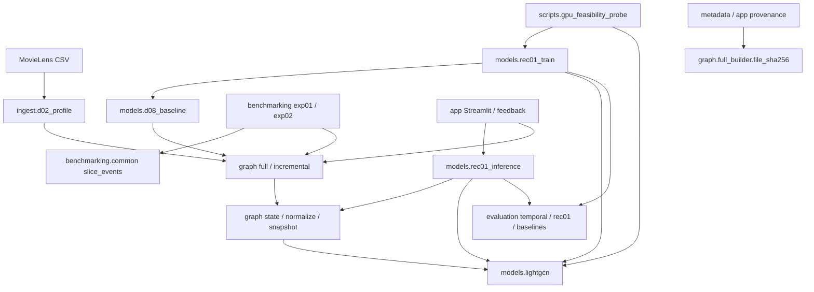
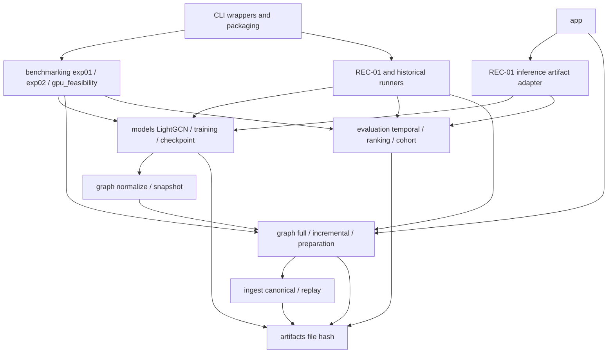

# GOAL 03.5 — Ponytail audit và kiến trúc đề xuất

Ngày kiểm tra: **22/11/2026 (Asia/Saigon)**. Đây là audit/target **trước refactor**. Phase B đã được Project Owner duyệt; xem [implementation và review](goal035-implementation-report.md) để biết trạng thái sau M0–M6. Các câu "chưa" bên dưới mô tả thời điểm audit, không phải trạng thái hiện tại.

## Repository làm gì và phạm vi audit

Repository canonicalize MovieLens, xây/cập nhật graph cumulative historical-positive, tạo normalized snapshots, train/evaluate LightGCN và phục vụ demo Streamlit. RQ1 nghiên cứu graph maintenance; RQ2 nghiên cứu model freshness. Giả định tải: một máy/single writer cho graph và demo, workload model đã chốt 4.999.981 cạnh, 49.587 users, 40.666 movies, 64 chiều/3 layers, một Kaggle T4. GOAL 04 chưa được triển khai.

Áp dụng `ponytail-audit`, ưu tiên correctness/reproducibility trước giảm code. GOAL 03.5 của Project Owner thay thế chỉ dẫn cũ về cutoff còn tentative và bắt buộc runtime source SHA-256. Việc thay module quan trọng vẫn phải được Owner duyệt trước.

## 1. Baseline và evidence

| Hạng mục | Kết quả quan sát |
| --- | --- |
| Repository | `khoakp/BigDataProject`, thư mục local `BigDataProject` bên trong workspace |
| Branch / HEAD | `refactor/v2-architecture` / `cec72b8ddbad76f5788cc37cd0e30fce6624f282` |
| Working tree ban đầu | Sạch; chưa tạo branch mới, chưa commit/push/merge |
| Python inventory | 73 tracked files: 35 `src`, 10 `scripts`, 28 `tests` |
| Markdown inventory | 49 tracked Markdown files trước audit |
| Full regression | **68 PASS, 0 FAIL, 0 ERROR, 0 SKIP; 39,409 s** |
| Lệnh | `..\venv\Scripts\python.exe -m unittest discover -s tests -v` |
| Environment | Python 3.10.11, Windows build 26300, torch 2.8.0+cu126, DuckDB 1.5.6, NumPy 2.2.6, pandas 2.3.3, PyArrow 25.0.1, psutil 7.2.2, Streamlit 1.54.0; CUDA available |
| Smoke độc lập | CSV 30 rows → canonical → Full/Incremental equivalence → snapshot export/load → LightGCN 2 BPR steps CPU → validation selection → held-out evaluation → Top-20: PASS |
| REC-01 cũ | Loader hiện tại nạp sealed Version 3; graph version 81, checkpoint step 300; 4 warm users và 1 cold user |
| REC-01 toàn bundle | `verify_output` kiểm uploaded input bundle, provenance và đủ **97 sealed output files**: PASS |
| Cohort model đã chốt | File hashes khớp manifest; **4.999.981 unique edges**, **49.587 users / 40.666 movies**, IDs 0–90.252 liên tục, đúng bipartite endpoints, mọi `first_event_ts < 1577836800`: PASS |
| Static import cycles | Không phát hiện cycle trong AST import graph; dynamic/path imports được liệt kê riêng |
| Markdown local links | 5 references tới file không tồn tại theo relative path, đều ở archive plan; chưa kiểm external URLs/anchor IDs |

Tài nguyên đã xác nhận: raw `../ml-32m/ratings.csv` 877.076.222 bytes, `movies.csv` 4.242.926 bytes, canonical 100k/1M, sealed REC-01 checkpoints 100/300/500 và model graph, raw EXP-01/02 CSV, cohort manifests/Parquet và local/T4 feasibility reports. Không chạy lại full profile, training 32M hoặc GPU benchmark.

Evidence mới, tách khỏi raw nghiên cứu:

- [Baseline summary](../results/goal035_baseline/baseline-summary.json): counts, command, environment. Full stdout transcript nằm trong temp của command và không được giữ; summary lấy từ kết quả thực chạy.
- [Inventory và dependency edges](../results/goal035_baseline/inventory.json): toàn bộ tracked tree trước thay đổi, symbols, AST edges kèm line, dynamic imports, Markdown và broken file links.
- [REC-01 trước refactor](../results/goal035_baseline/rec01-before.json): SHA-256 artifact, Top-20 IDs/scores của users `2, 25062, 101198, 200939`, cold user `200940`; CPU/1 thread.
- [Smoke trước refactor](../results/goal035_baseline/smoke-before.json), [fixture reproductions](../results/goal035_baseline/audit-reproductions.json), [overwrite reproduction](../results/goal035_baseline/overwrite-reproduction.json).
- [Protected files](../results/goal035_baseline/protected-files.json): hashes/size của raw datasets, canonical prefixes, raw CSV, cohort manifests, sealed graph DB và frozen report/manifest.
- [Artifact integrity trước refactor](../results/goal035_baseline/artifact-verification-before.json): toàn sealed REC-01 output và Parquet của selected cohort 5M; kiểm chỉ đọc, không tái tạo graph từ raw 32M và không suy ra kết quả performance/quality.
- [Capture script](../results/goal035_baseline/capture_baseline.py): mã ghi evidence trước refactor, không phải API runtime. Không dùng để ghi đè baseline sau refactor.

## 2. Findings theo mức ưu tiên

### MUST FIX

1. **Full Rebuild chấp nhận canonical prefix bị lỗi** — [full_builder.py](../src/graph/full_builder.py), `_rebuild`, dòng 35–37; [common.py](../src/benchmarking/common.py), `slice_events`, dòng 25–28.
   - **Chức năng:** reference graph và replay slicing phải xác định đúng cùng một event stream.
   - **Vấn đề/tác động:** IDs `[0,1,1,3]` có count/min/max hợp lệ nên Full nhận 4 cạnh; Incremental từ chối. Đã tái hiện. Full còn không kiểm field domains/canonical ordering, khiến reference có thể xác nhận input mà replay không chấp nhận.
   - **Sửa tối thiểu:** một canonical validation contract dùng chung, kiểm schema, null/domain, ID uniqueness/contiguity và thứ tự `(event_ts,user,movie,source_row)`; tiếp tục giữ validation boundary/watermark trong transaction của Incremental. Không chỉ thêm `DISTINCT` rồi bỏ các kiểm tra còn lại.
   - **Nếu hoãn:** RQ1 có hai định nghĩa đầu vào khác nhau; thêm negative fixtures trước khi sửa. Không dùng shared validator thay cho implementation Full/Incremental độc lập.

2. **Canonicalizer xuất raw IDs mà graph replay cấm** — [d02_profile.py](../src/ingest/d02_profile.py), `run`, dòng 38–63; [temporal_profile.py](../src/ingest/temporal_profile.py), `profile`; [model_cohort.py](../src/evaluation/model_cohort.py), `prepare_cohorts`.
   - **Chức năng:** CSV → canonical events/profiling/cohort phải thống nhất domain dữ liệu.
   - **Vấn đề/tác động:** CSV `0,10,4,1` được D02 xuất thành canonical; Incremental yêu cầu IDs > 0. Temporal profiler đã kiểm điều này, còn cohort builder lọc raw ratings trực tiếp mà không có cùng validation.
   - **Sửa tối thiểu:** thống nhất raw validation trước export/chọn cohort; test zero/negative/null IDs, half-star rating và timestamp. Manifest mới ghi threshold 4.0; không sửa manifest D02 cũ `not_chosen`.
   - **Nếu hoãn:** pipeline có thể thất bại muộn hoặc tạo graph nghiên cứu từ input không hợp lệ. Dữ liệu MovieLens hiện có không bị cáo buộc hỏng bởi finding này.

3. **Output cũ có thể bị ghi đè** — [d02_profile.py](../src/ingest/d02_profile.py), `run`; [full_builder.py](../src/graph/full_builder.py), `_rebuild` export block.
   - **Chức năng:** hai entrypoints tạo canonical và reference artifacts.
   - **Vấn đề/tác động:** gọi lại cùng output với CSV khác thay canonical/graph Parquet và manifest; đã tái hiện bằng temp files, hashes trước/sau khác nhau. CLI defaults trỏ tới đường dẫn artifact đã tồn tại.
   - **Sửa tối thiểu:** từ chối trước khi ghi nếu target artifact files đã tồn tại; vẫn cho phép thư mục rỗng/precreated của EXP-01 worker. Không thêm cờ overwrite cho sealed evidence.
   - **Nếu hoãn:** thao tác chạy lại có thể làm mất khả năng tái lập. Test giữ nguyên toàn bộ bytes sau lần ghi bị từ chối, kiểm callers EXP-01/D08/D10.

4. **Source hash khóa mọi refactor vào runtime cũ** — [rec01_inference.py](../src/models/rec01_inference.py), `RUNTIME_CODE` và constructor dòng 24–63.
   - **Chức năng:** kiểm provenance trước nạp selected checkpoint.
   - **Vấn đề/tác động:** đổi docstring/refactor tương đương ở một trong sáu file cũng từ chối sealed checkpoint; test hiện tại chủ động yêu cầu hành vi đó. Đây là thay đổi contract đã được Owner cho phép trong GOAL 03.5, không phải lý do bỏ integrity.
   - **Sửa tối thiểu:** bỏ mandatory runtime source-byte equality; giữ historical hashes làm provenance. Legacy REC-01 loader giữ config/hash, tensor keys/shapes, node mapping, graph version, normalization, cutoff và checkpoint integrity; artifact mới ghi version/Git provenance rõ ràng.
   - **Nếu hoãn:** không thể hợp nhất core một cách an toàn. Gate bắt buộc: so cùng artifact với [baseline Top-20](../results/goal035_baseline/rec01-before.json), IDs bằng đúng thứ tự; scores `atol=1e-6, rtol=1e-6`, CPU/1 thread. Không cập nhật baseline theo kết quả mới.

5. **Nhiều nguồn “hiện hành” mâu thuẫn** — [AGENTS.md](../AGENTS.md) đoạn scope/source pinning; [system design](03-system-design.md), phần v2 và next gates; [archive index](archive/README.md).
   - **Chức năng:** hướng dẫn quyết định khoa học và thứ tự triển khai.
   - **Vấn đề/tác động:** cùng tài liệu vừa tentative vừa approved cutoff 2020; system design vẫn chờ profiling/T4 dù đã có evidence; archive index trỏ kế hoạch 21 ngày như tiến độ hiện hành. README/AGENTS vẫn yêu cầu pin runtime source.
   - **Sửa tối thiểu:** một scope/decision authority v2, một architecture, một protocol, một progress/evidence index; README/AGENTS chỉ dẫn liên kết và quy tắc. Archive nội dung cũ, giữ các kết quả đo nguyên văn.
   - **Nếu hoãn:** agent/người mới có thể đổi cutoff, chạy lại nghiên cứu đã xong hoặc triển khai sai RQ. Chốt facts theo GOAL Owner, không suy luận từ lịch sử milestone.

### SHOULD FIX

6. **Reusable graph/training code nằm trong milestone runners** — [d08_baseline.py](../src/models/d08_baseline.py), `train_only_graph`, `incremental_train_graph`, `sample_batches`; [rec01_train.py](../src/models/rec01_train.py), import dòng 32 và `_sample_batches`; [gpu_feasibility_probe.py](../scripts/gpu_feasibility_probe.py), import `_sample_batches`.
   - **Chức năng:** train graph preparation và sampling hiện được nhiều workflow dùng.
   - **Vấn đề/tác động:** REC-01 → D08; GPU probe → private REC-01 helper. Hai samplers thực hiện cùng sequence (test hiện tại chứng minh), nên thay rule phải sửa nhiều chỗ; BPR optimizer step cũng lặp trong runners.
   - **Sửa tối thiểu:** chuyển graph preparation sang `graph/preparation.py`, sampler và BPR step sang `models/training.py`, dùng một implementation. D08/REC-01 giữ protocol orchestration và tên import cũ nếu callers còn cần.
   - **Nếu hoãn:** GOAL 04 tiếp tục phụ thuộc milestone-specific code. Giữ sampler deterministic và chọn checkpoint trước test như hiện tại.

7. **File hashing bị sao chép và tạo dependency sai tầng** — `file_sha256/sha256/sha256_file` ở Full Builder, D02, temporal profiler, cohort builder và các packaging/audit/probe scripts.
   - **Chức năng:** SHA-256 streaming cho artifact provenance.
   - **Vấn đề/tác động:** nhiều implementation giống nhau; metadata và app import cả graph builder chỉ để hash một file. Sửa chunking/error behavior phải tìm nhiều bản sao.
   - **Sửa tối thiểu:** một `src/artifacts.py:file_sha256`, callers import trực tiếp; giữ export alias khi compatibility cần. **Ngoại lệ:** Kaggle bootstrap runner xác minh source trước khi project được copy/import nên giữ helper stdlib độc lập ở đó.
   - **Nếu hoãn:** dependency graph khó hiểu, dễ bỏ sót provenance callers. Không gom row-checksum (`equivalence.checksum`) với file-byte hash vì contract khác nhau.

8. **Thiếu negative tests cho tensor/config compatibility** — [test_rec01_inference.py](../tests/test_rec01_inference.py), `Rec01InferenceTest`.
   - **Chức năng:** test loader hiện bao phủ file tampering, model IDs, version, protocol hash và selected checkpoint.
   - **Vấn đề/tác động:** chưa trực tiếp test sai embedding shape/layers/config sau khi outer hashes nhất quán. Loader có checks/strict state loading, nhưng refactor có thể vô tình bỏ chúng mà suite vẫn xanh.
   - **Sửa tối thiểu:** tamper bản sao toy checkpoint/report và cập nhật outer hashes để đi tới semantic checks; yêu cầu từ chối tensor shape, config, checkpoint registry và normalization mismatch.
   - **Nếu hoãn:** source-pin removal thiếu bằng chứng thay thế cần thiết. Không tạo tampered copies trong sealed run directory.

9. **Normalization và ranking có chi phí lớn đã nhận diện** — [d08_baseline.py](../src/models/d08_baseline.py), `incremental_train_graph`; [snapshot.py](../src/graph/snapshot.py), `materialize_normalized`/`freshness`; [temporal.py](../src/evaluation/temporal.py), `score_chunks`.
   - **Chức năng:** train preparation normalize full reference rồi bỏ adjacency; normalize incremental state, sau đó snapshot normalize lại. `freshness` tải/verify toàn COO chỉ để lấy watermark.
   - **Vấn đề/tác động:** các Python state/COO copies tăng CPU/RSS theo toàn graph. Ranking mỗi user × movie chunks thực hiện nhiều tensor allocation/CPU sync; 40.666 candidates cần 40 chunks/user, không được suy latency full cohort từ probe 100 users.
   - **Sửa tối thiểu:** bỏ kết quả normalization bị bỏ đi khi extract preparation; giữ validation thực sự cần. Hoãn đổi backend/thuật toán ranking và snapshot validation sang task có phép đo riêng; không dùng timing lịch sử cho implementation đã đổi.
   - **Nếu hoãn:** còn chi phí thừa nhưng chưa có bằng chứng OOM ở workload đã chốt. Đây là debt hiệu năng, không phải lý do viết lại LightGCN hoặc chạy GPU benchmark mới trong GOAL này.

10. **Kaggle timeout bị ghi đè bằng trạng thái report chưa hoàn tất** — [kaggle_feasibility_runner.py](../scripts/kaggle_feasibility_runner.py), `main`, dòng 169–174.
    - **Chức năng:** runner lưu status sau subprocess timeout.
    - **Vấn đề/tác động:** `TIMEOUT` vừa gán bị `record.update(status=report.get('status'))` đổi thành `RUNNING` nếu report tồn tại. `returncode=None` vẫn giữ nhưng summary status không mô tả đúng nguyên nhân dừng.
    - **Sửa tối thiểu:** ưu tiên timeout/nonzero exit ở summary, lưu report status riêng nếu cần; test subprocess giả timeout với report `RUNNING`. Không chạy Kaggle lại.
    - **Nếu hoãn:** người đọc summary phải suy lỗi từ returncode; không sửa raw T4 reports đã freeze.

11. **Archive có relative links hỏng sẵn** — [old seven-week plan](archive/04-project-plan-7weeks-archived.md), dòng 12, 154, 185.
    - **Chức năng:** dẫn tới work log, decisions và experiment log.
    - **Vấn đề/tác động:** 5 links thiếu `../`, trỏ file không có trong archive. Migration tiếp dễ nhân thêm lỗi.
    - **Sửa tối thiểu:** sửa theo migration map, scan toàn bộ local Markdown files/anchors và code path references; frozen report giữ nguyên, đặt tài liệu đích/link compatibility phù hợp.
    - **Nếu hoãn:** mất đường dẫn đối chiếu evidence dù artifact còn tồn tại.

**Verdict:** sửa MUST FIX 1–5 theo migration được duyệt, thêm các tests ở 8 trước nghiệm thu. Không có finding dead-code/export nào đủ bằng chứng để xóa; DXX/SXX còn được tests, CLI, subprocess hoặc report generators dùng. Không phát hiện nhu cầu thêm dependency, ABC, factory hay manager. Lean: có thể hợp nhất hai samplers và nhiều file-hash helpers; chưa đo LOC savings, không dùng LOC làm KPI.

## 3. Dependency map trước thay đổi



Mũi tên từ module tới dependency, trừ nhánh CSV biểu diễn dữ liệu. `D09 → D08`, `D10 → D09/D02`, `evaluation.s02_probe → D08.ROOT` là các cạnh legacy bổ sung. Toàn bộ edges và dynamic imports nằm trong inventory; ba tests dùng `spec_from_file_location`, runner dùng subprocess `python -m`, packaging duyệt `src/**/*.py`. Không coi những entrypoints đó là dead code.

## 4. Target architecture — ĐỀ XUẤT, chưa tồn tại

Giữ package names đang phù hợp (`ingest`, `benchmarking`, `metadata`); không đổi toàn repo sang `data/experiments` chỉ để đổi tên. Bổ sung module khi có reusable logic/caller cụ thể:

```text
src/
  artifacts.py                 # shared file-byte hash; không phải artifact manager
  ingest/
    canonical.py               # D02 implementation + canonical/raw validation contract
    replay.py                  # slice_events, không import benchmarking
    temporal_profile.py        # giữ nghiên cứu temporal đã có
    d02_profile.py             # CLI/import compatibility tới canonical
  graph/
    full_builder.py, incremental.py, equivalence.py
    normalize.py, snapshot.py
    preparation.py             # train-only/full/incremental preparation từ D08
    d04_probe.py ... d06_probe.py  # historical CLI còn caller
  models/
    lightgcn.py                 # thuật toán hiện tại
    training.py                # deterministic sampler, reusable BPR optimizer step
    checkpoint.py              # explicit serialization/compatibility contract
    rec01_train.py             # REC-01 protocol runner, gọi core
    rec01_inference.py         # legacy artifact adapter + public inference API
    d07_probe.py ... d10_mvp.py # historical runners, dùng core khi tương đương
    d10_demo.py, rec01_demo.py  # CLI compatibility
  evaluation/                  # temporal, metrics, popularity, selection, cohort giữ ranh giới
  benchmarking/
    common.py                  # measurement helpers, không sở hữu data slicing
    exp01.py, exp02.py, *_analysis.py
    gpu_feasibility.py         # probe workload orchestration chuyển từ scripts
  metadata/movie_lookup.py
  app/                         # existing research/demo UI
scripts/
  gpu_feasibility_probe.py      # thin CLI/import compatibility
  *_prep.py, *_runner.py        # packaging và bootstrap theo môi trường
  s*.py                        # historical evidence/report tools
tests/                         # giữ invariant tests và compatibility callers
```

`checkpoint.py` chỉ chứa logic được training/inference dùng thực tế; không tạo plugin registry hay generic format framework. REC-01 là artifact format lịch sử nên giữ adapter mang tên đó. GPU probe checkpoint là diagnostic artifact khác; không được tự coi là REC-01 compatible hoặc sửa metadata của file đã có.



Đây là dependency graph **sau refactor dự kiến**, không phải kết quả đã triển khai. Core không import DXX/SXX/REC-01 runners hay `scripts`; orchestration được phép import core. Metadata lookup giữ riêng, chỉ enrich sau ranking.

### Contracts cần bảo vệ

| API | Input → output và gate |
| --- | --- |
| Canonicalization/replay | CSV → Parquet ordered canonical IDs; slicing giữ event IDs, không renumber từng batch; raw IDs > 0, half-star [0.5,5], deterministic ties |
| Full/Incremental | Cùng canonical prefix/watermark → unique positive edges, stable node IDs và exact degrees; replay NO_OP, conflict reject, rollback giữ nguyên |
| Snapshot | Version `v` → registry + symmetric `D^-1/2 A D^-1/2`, no self loops, float64 logical weights; export immutable; Torch chuyển float32 đúng một lần |
| Training | Train-only graph + seed → deterministic triples/BPR step; giữ Adam/loss/layer averaging; không đọc test trước checkpoint selection |
| Checkpoint | Legacy format nhận diện rõ; artifact mới versioned + Git provenance; strict keys/shapes/config/mapping/version/normalization; checkpoint hash vẫn bắt buộc theo artifact contract |
| Inference/evaluation | Train-catalog candidates + seen mask + raw-ID tie-break → Top-K; popularity/cold exclusions và Recall/NDCG không đổi |

V2 base là `< 1577836800`, replay `>= 1577836800`. **Không đổi** REC-01 lịch sử dùng `<= train_end_ts` và cutoffs riêng. Cohort node IDs theo raw-ID order khác canonical first-positive IDs; `first_event_ts` không phải `first_event_id`. Không cast/đổi nhãn hai graph formats để ép cùng checkpoint.

## 5. Migration nhỏ và điều kiện kiểm chứng

| Bước | Thay đổi sau khi được duyệt | Callers/tests phải theo | Gate |
| --- | --- | --- | --- |
| M0 | Tạo `refactor/v2-cleanup` từ HEAD baseline; giữ audit files uncommitted | Kiểm HEAD/status lại; không commit | Không mất local changes |
| M1 | Loại runtime source pin theo contract mới; giữ integrity; thêm loader negative tests | REC-01 train/inference, app, fixtures, source archives | Same sealed checkpoint: exact Top-20 IDs, score tolerance, reject mismatch; hash protected files không đổi |
| M2 | Canonical/replay/preparation extraction và fixes 1–3 | D02/D08/D09/D10, EXP-01/02, probes, dynamic imports | Invalid input reject; deterministic canonical bytes; full equivalence; rollback/no-op; old CLI vẫn chạy |
| M3 | Shared training/checkpoint APIs và hash helper; move probe business logic | D08/REC-01, probe, `*_prep`, source provenance lists, test patch targets | Seed sampler equivalence; BPR/embedding numerical equivalence; checkpoint toy roundtrip; package import smoke |
| M4 | Fix runner timeout summary, bỏ normalization bị bỏ đi | Kaggle runner fake subprocess; prepare/probe tests | Không đổi raw report hoặc measured timing boundaries một cách ngầm định |
| M5 | Documentation consolidation theo map | README, AGENTS, docs relative links, freeze/report/package scripts | Current facts thống nhất; frozen hashes giữ nguyên; links và code references hợp lệ |
| M6 | Full regression, E2E, Ponytail review, Vietnamese walkthrough | Toàn diff và affected callers | 0 MUST FIX; SHOULD FIX resolved/deferred với lý do; báo cáo before/after thực tế |

Chạy `ponytail-review` sau M1, M2, M3–M4 và cuối M6; xem cả connected callers, không chỉ diff. Không thêm dependency. Chưa có refactor diff để chạy final review tại bước thiết kế này.

## 6. Hợp nhất tài liệu

Nguồn v2 đích: `docs/current/scope-and-decisions.md`, `architecture.md`, `experiment-protocol.md`, `progress-and-evidence.md`; sau refactor thêm `architecture-walkthrough-vi.md`. `docs/research/README.md` là evidence index liên kết tới kết quả/raw artifacts, không sao chép số liệu. README nói đề tài, pipeline, cách chạy và trạng thái; AGENTS ngắn, reuse-first, invariant/reproducibility và hướng dẫn giải thích tiếng Việt.

Map **đủ 49 Markdown files** ở [documentation migration map](goal035-documentation-map.md). `CURRENT`, `RESEARCH EVIDENCE`, `HISTORICAL`, `DUPLICATE`, `OBSOLETE` mô tả vai trò hiện tại, không phải lệnh xóa.

- Split system design: lưu nguyên bản thiết kế cũ vào archive trước khi đưa implementation/contracts còn đúng sang current. Old path có thể làm link stub để bảo toàn references từ report đóng băng.
- Hợp nhất scope/decisions/protocol từ nhiều file vào current bằng liên kết tới evidence. Các work/research logs chứa raw observations giữ lịch sử, không viết lại kết quả.
- `docs/final-report.md` nằm trong `s12-freeze-manifest.json`: giữ nguyên bytes/path. Các report-assets có entries hash cũng giữ nguyên. S12/S14 manifests và ZIP cũ giữ nguyên; không regenerate để làm xanh integrity sau source migration.
- Packaging/report generators có hardcoded docs paths; cập nhật callers cần thiết hoặc giữ compatibility link stubs. Kaggle bootstrap/source ZIP composition phải được kiểm khi move module.
- DXX/SXX evidence có historical label/index; chỉ archive/move khi links/manifests/callers đã được xử lý. Không xóa một document chỉ vì cũ.

## 7. Remaining debt và GOAL 04 readiness

**Hiện tại chưa sẵn sàng nghiệm thu GOAL 03.5 hoặc bắt đầu GOAL 04.** Baseline hoạt động nhưng còn MUST FIX và chưa có phê duyệt kiến trúc. Sau migration, GOAL 04 có thể dùng graph/training/checkpoint/ranking contracts; model freshness engine, persisted propagated embeddings version, policy cho new nodes và thí nghiệm refresh vẫn là công việc GOAL 04, không triển khai ở đây.

Debt dự kiến giữ: Python full-state/COO materialization, per-user ranking, một process feedback writer, bootstrap hash helper riêng, historical CLI wrappers phục vụ reproducibility. Từng debt cần nêu limit và evidence; không coi những thiết kế có phạm vi rõ là lỗi production giả định.

Walkthrough cuối task phải giải thích bằng tiếng Việt: module/input/output, một rating mới, Full/Incremental, normalization, train/inference, điểm tích hợp GOAL 04; Mermaid, ví dụ nhỏ và câu hỏi tự kiểm tra. Chưa viết nó như kiến trúc đã triển khai khi Owner chưa duyệt target.

**Not checked:** không chạy 32M training, benchmark GPU mới, remote Kaggle jobs, export DOCX/PDF/ZIP; không xác minh external URLs/papers hay từng trang của binary reports. Đã map toàn bộ Python/Markdown tracked; đọc sâu core graph, temporal evaluation, training/inference, feedback, benchmark runners và packaging dependencies. Không khẳng định đã review từng dòng prose lịch sử, từng plotting/report-formatting branch hay mọi ignored artifact. Mọi existing tracked files còn nguyên; chỉ thêm audit/evidence mới.

## Quyết định xin duyệt

Duyệt target module boundaries, compatibility wrappers và documentation consolidation ở mục 4–6, cùng branch `refactor/v2-cleanup`, để bắt đầu M0–M6. Đây là gate **do GOAL 03.5, Phase B và Execution Order Step 3 yêu cầu**, không phải yêu cầu thêm của Ponytail. Không cần duyệt lại việc bỏ mandatory runtime source SHA-256 vì Owner đã phê duyệt trong Phase D; vẫn phải đạt compatibility tests.
