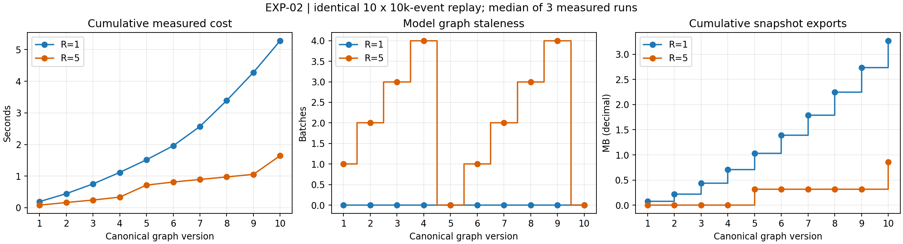

# D13 — EXP-02: chu kỳ chuẩn hóa R=1 và R=5

> **Hồ sơ lịch sử GOAL 03.5:** giữ để truy nguồn quyết định/kết quả cũ. [Phạm vi v2 hiện hành](../current/scope-and-decisions.md) · [Tiến độ v2](../current/progress-and-evidence.md).

**Ngày:** 21/11/2026. **Run chính:** `D13-100k-r1-r5-final`, status PASS. Đây là chi phí tạo và export **normalized model graph snapshot**, không đo training/serving LightGCN.

## Phương pháp và ranh giới đo

- Input: cùng canonical prefix 100.000 sự kiện MovieLens 32M, SHA-256 `8a01bc6f132362f44ab5a206575fb16ab7f34ce44c6bd224b418ea076c7bf519`; chia 10 batch liên tiếp, mỗi batch 10.000 sự kiện. Cả hai chế độ replay đúng một dãy batch.
- `R=1`: materialize và export sau mọi batch. `R=5`: materialize và export tại v5, v10. Cả hai bắt đầu từ snapshot rỗng v0; chi phí tạo v0 nằm ngoài timer. Giữa hai lần refresh, canonical state vẫn cập nhật.
- Mỗi chế độ: một warm-up và ba measured repetitions, mỗi lượt trong process/DB mới. Thứ tự chế độ shuffle theo seed 7. DuckDB một thread; cache OS không reset được nên ghi `warm-cache-uncontrolled`.
- `cumulative_s` cộng thời gian `apply_batch`, `materialize_normalized` (bao gồm đọc/validate state, tính COO, ghi snapshot DuckDB) và export Parquet/manifest. Không gồm tạo batch input, mở process/DB, snapshot v0, load để so sánh hoặc plot. `app_bytes_written` là payload export; `peak_rss_bytes` là mẫu RSS mỗi 5 ms, không phải peak tuyệt đối. OS I/O và DB growth có từng dòng CSV.
- `staleness_batches = canonical_version - model_graph_version`; `staleness_events` dùng chênh watermark event ID. Với R=5, v1–v4 dùng v0 rỗng nên **chưa có graph hữu ích trước refresh đầu tiên**. Đây là khác biệt availability quan trọng bên cạnh độ cũ.
- Tại v5/v10 mỗi lượt, load lại hai bản export, đối chiếu node registry, sparse shape/coordinates, COO hash và giá trị float64 với `atol=1e-12`.

## Kết quả đo thực

Các ô thời gian là median của ba measured repetitions; khoảng min–max trong ngoặc. Cumulative wall time là tổng ba pha được đo, không phải process elapsed time.

| Chỉ số | R=1 | R=5 |
|---|---:|---:|
| Tổng ba pha, giây | 5,283 (5,253–5,320) | 1,648 (1,625–1,724) |
| Canonical update, giây | 1,035 | 0,822 |
| Materialize, giây | 2,717 | 0,508 |
| Export, giây | 1,519 | 0,298 |
| Số snapshot sau v0 | 10 | 2 |
| Export bytes tổng | 3.270.467 | 856.995 |
| Peak RSS lấy mẫu, MiB | 128,37 | 104,01 |
| Staleness tối đa | 0 batch / 0 events | 4 batches / 40.000 events |
| Staleness trung bình theo 10 boundary | 0 batch | 2 batches |

Tỉ số median tổng thời gian `R=1 / R=5 = 3,206` trong run này. Chênh lệch chủ yếu do số lần materialize/export (10 so với 2), và hai chế độ **không cùng mức freshness**. Canonical update cũng khác giữa lượt chạy dù cùng dữ liệu; cache/DB state và thứ tự chạy chưa được kiểm soát hoàn toàn, nên không diễn giải riêng chênh này như tác động nhân quả của cadence. Không suy rộng tỉ số sang 1M/32M hay chất lượng gợi ý.

Tất cả 80/80 raw rows PASS (20 warm-up, 60 measured). Tám common-boundary comparisons tại v5/v10 đều PASS, `coordinates_equal=true`, `max_abs_diff=0`. R=1 có staleness 0 ở mọi boundary; R=5 có chu kỳ `1,2,3,4,0` lặp hai lần. Không đo event-time lag vì timestamp của batch không phải thời gian hệ thống phục vụ.



## Bằng chứng và tái chạy

- Raw per-batch: `results/raw/exp02_normalization.csv`; summary: `results/raw/exp02_summary.json`; report và từng export: `data/processed/d13_exp02/D13-100k-r1-r5-final/`.
- Code: `src/benchmarking/exp02.py`, `src/benchmarking/exp02_analysis.py`, `src/graph/snapshot.py`; toy test: `tests/test_exp02.py`.
- Machine: Windows 10 build 26300, Intel Family 6 Model 183, RAM 16,78 GB, Python 3.10.11, DuckDB 1.5.6. Repo HEAD `123942550cf8192e5cc85f1c6f1432216ff39ab5`, worktree dirty. `config_sha256=3020611ada001f270c529c6a7560041357426a66df8d2ee8f64665b50d7ad3c1`, harness `code_sha256=bac765fee5750d61621ae770cb5110afc921da41c753bbb83d97096228304235`, snapshot writer SHA-256 `7e5ee6558fdcc15d2fa64a69790bc318e787ca1cb95ba32fc4257622779ebc0d`.

```powershell
..\venv\Scripts\python.exe -m src.benchmarking.exp02 run --out data/processed/d13_exp02/my-fresh-run --csv results/raw/my-exp02.csv
python -m src.benchmarking.exp02_analysis --csv results/raw/my-exp02.csv --summary results/raw/my-exp02-summary.json
..\venv\Scripts\python.exe -m unittest discover -s tests
```

Trước run chính có hai lượt chẩn đoán bị dừng ở các batch đầu vì cách ghi `unnest` từ Python sang DuckDB mất ~75 giây ngay v1 ở 10k events. Thay bằng `INSERT ... SELECT` trực tiếp từ canonical tables, rồi rerun toy, toàn bộ 29 tests và phép so sánh export ở v5/v10. Thư mục chẩn đoán `D13-100k-r1-r5` và `D13-100k-r1-r5-retry` không chứa số liệu hợp lệ cho EXP-02; chỉ run `-final` được dùng trong bảng trên.
