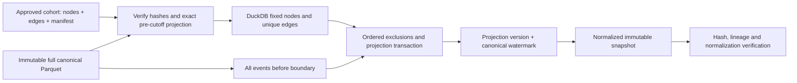

# GOAL 04 Phase B — Versioned Model Graph Replay

Ngày 23/11/2026. Trạng thái: implementation và toy verification hoàn thành, chờ Owner nghiệm thu. Không chạy Phase C. Branch `develop/v2`, base HEAD `1745739744f6f4aae0d97ddf83d03a7a80eacbb9`, working tree có thay đổi Phase A được giữ nguyên; chưa commit/push/merge.

## Điều kiện approval đã xử lý

[Protocol hiện hành](../current/experiment-protocol.md) sở hữu định nghĩa duy nhất:

- Offline quality và serving-like ranking có user-selection và timer riêng. Serving-like chọn từ observed 90-day history trước boundary; S0/S1/S2 chia sẻ users/catalog/mask, không đọc future labels để định workload.
- Primary quality run là repetition 1 trong 3. Phase D/E có tối đa 99 S1 forwards + 1 P0 forward, không run thứ tư hay unbudgeted warm-up/retry. October giữ counts descriptive, không thêm refresh. Whole-run elapsed tính cả offline quality và I/O; serving-like cost chỉ tổng hợp các pha tương đương qua 3 repetitions. Ngân sách thực tế GPU vẫn cần duyệt sau Phase B.
- Ghi rõ bias: C0 được chọn trên stale-G0 validation, nên kết quả so S1 conditional trên cơ chế chọn C0 đó; không chứng minh phương pháp luôn vượt trội.

## Implementation và data flow

`src/graph/model_replay.py` là reusable graph module. Không có optimizer, model forward, quality evaluator hoặc training runner trong module này.



| API | Input → output và contract |
| --- | --- |
| `ModelGraphReplay.create(database, cohort, events)` | Fresh DB path, cohort directory, full canonical Parquet → initialized projection v0; verifies node/edge file hashes, positive semantics, canonical schema/order and exact base edges/timestamps |
| `ModelGraphReplay(database)` | Existing initialized DB → reopen; verifies source bytes, fixed mapping and current state hashes against ledger |
| `advance(boundary)` | Integer UTC seconds → consumes `[previous_boundary,boundary)`, returns version/watermark/exclusion counts; repeat boundary is `NO_OP` |
| `state()` | Current projection → existing `registry`, `edges`, `degrees` shape; degrees derived exactly by SQL incident counts |
| `export_snapshot(output, expected_version=...)` | Fresh output directory and current version → nodes/edges/degrees/adjacency Parquet + manifest; rejects attaching an old version to current graph |
| `load_projection_snapshot(path, expected_mapping=..., expected_version=..., expected_boundary=..., expected_source=...)` | Snapshot + caller's expected lineage → manifest/state/SparseAdjacency; rejects mismatched files, mapping, source, version, boundary or normalized weights |

Canonical source **must contain complete events from ID 0**, not only selected users or positive events. Its bytes are pinned by SHA-256 and rechecked before replay/export; canonical validation happens on creation. The producer/experiment manifest must retain raw CSV → canonical-file provenance. This module validates canonical format and base-projection equality; it does not regenerate canonical data from raw CSV or independently prove the entire future stream is the original raw dataset.

Cohort `nodes.parquet` owns exact embedding indices; IDs can be interleaved user/movie and need not match canonical registration order. Base edges contain `first_event_ts`, while runtime edges retain the **first canonical event ID**. Initialization joins timestamps back to canonical events and compares both directions with `EXCEPT ALL`; it never treats a timestamp as event ID. Node `first_event_id` records first pre-cutoff positive appearance in the canonical stream and remains fixed.

Incremental replay groups positive pairs by earliest event ID in the interval, joins fixed mapping and pre-cutoff positive entity sets, then partitions user-cold → user-omitted → movie-cold → movie-omitted → seen → inserted. Duplicate positives within interval are counted separately from unique pairs. Ratings below 4 do not remove edges. The transaction includes edge insertion and ledger write; an error after either write rolls both back. Empty/all-negative intervals can advance boundary/version without changing edges. Retry of an older recorded boundary returns its record without rewinding current state.

`projection_version` advances per newly observed boundary. `canonical_watermark_event_id` is the last **all-event** ID `< boundary`, including excluded/negative events; last canonical tuple is stored. `canonical_graph_version` is explicitly null: this path does not materialize the full canonical graph. Boundaries beyond the captured source end + one second are rejected. Future events at exactly the boundary cannot enter the state. Selecting rows with `< boundary` consumes every earlier timestamp tie completely.

Normalization reuses `normalize_state`: symmetric `D^(-1/2) A D^(-1/2)`, no self loops, unique binary edges; each direction has weight `1/sqrt(degree(u)*degree(i))`. Exported SQL COO is compared with the existing Python normalization contract on reload, float64 tolerance `1e-12`. Snapshots carry source/cohort/mapping/state/COO hashes, event watermark, projection version, observed cutoff and creation time. Experiment-level Git/config/source hashes are recorded by the caller/report; no fake checkpoint or propagated-embedding version is created in Phase B.

## Ví dụ và cách dùng

User A có positive X trước cutoff. Tại timestamp đúng boundary b, A positive Y hai lần và một user ngoài cohort positive X. Graph tại b vẫn chỉ có cạnh A–X. Khi advance tới b+1, A–Y được thêm đúng một lần, hai events positive của A đều đã được quan sát, user ngoài cohort được ghi exclusion; model IDs không đổi. Degree của A tăng một, nên trọng số cạnh cũ A–X cũng phải normalize lại. Watermark vẫn đi qua event ngoài cohort.

```python
from pathlib import Path
from src.graph.model_replay import ModelGraphReplay

# Paths/config/hashes belong to the experiment manifest. This example is not
# evidence that a full MovieLens canonical artifact has already been prepared.
with ModelGraphReplay.create(
    Path("new_projection.duckdb"),
    Path("results/model_cohort_v2_final/edges_5000000"),
    Path("full_canonical_events.parquet"),
) as graph:
    record = graph.advance(1609459200)  # observed events strictly before 2021
    graph.export_snapshot(Path("new_snapshot_2021_01"),
                          expected_version=record["projection_version"])
```

## Verification và evidence

Baseline **75 PASS**, final regression **83 PASS, 0 FAIL, 0 SKIP**. Eight new tests exercise:

- Independent Python full scan versus incremental edges/degrees/COO at six boundaries; deliberately different canonical/model IDs.
- Boundary equality, ties, repeated positives, all ordered exclusion categories, negative and empty intervals.
- Reopen, retry idempotency, backwards/out-of-coverage rejection, transaction rollback after edge and version writes.
- Changed canonical source, invalid canonical IDs, changed mapping, wrong cohort hash, semantically wrong base despite updated file hash.
- Snapshot mismatched mapping/version/source/boundary, wrong temporal provenance, altered file bytes, incorrect COO even with updated outer file/COO hashes; old snapshot stays immutable after replay.

[Smoke JSON](../../results/goal04_projection/smoke.json) records the measured toy run, hashes, environment, boundaries and equality results. Edge counts are **2 → 3 → 3 → 4 → 4 → 4**; all six match the independent reference. This elapsed time is a small CPU correctness smoke, **not a serving benchmark or 5M resource measurement**. No LightGCN forward or optimizer call occurred.

[Baseline log](../../results/goal04_projection/baseline.log), [targeted log](../../results/goal04_projection/targeted.log), [full regression](../../results/goal04_projection/regression.log). Reproduce from repository root:

```powershell
..\venv\Scripts\python.exe -m unittest tests.test_model_replay -v
..\venv\Scripts\python.exe -m unittest discover -s tests -v
```

Toy fixtures use temporary directories, not real datasets/checkpoints. Existing tests remain intact. `git diff --check` passes. No raw MovieLens, historical reports, sealed artifacts or old graph APIs were changed.

## Giới hạn và điểm dừng

- Chưa chạy replay/normalization trên toàn workload 5M, chưa có performance/RAM claim. DuckDB base joins/grouping tránh materialize full canonical graph, nhưng `state()`/checksums/normalization vẫn tạo Python rows/COO như core hiện có; memory có thể lớn. Rehash toàn canonical source mỗi boundary cũng có I/O cost phải tính vào setup. Chỉ tối ưu sau khi đo, không bỏ integrity checks âm thầm.
- API là single-writer trên immutable source. Failed initialization để lại file chẩn đoán, không tự overwrite; failed export directory thiếu/không hợp lệ manifest không được coi là snapshot hoàn tất. Chọn fresh output khi chạy lại.
- Source và mapping hashes xác định lineage; experiment manifest phải liên kết protocol approval, Git/source/config hashes và raw→canonical provenance. Source path hiện là local absolute path; di chuyển file cần workflow migration rõ ràng, không tự tìm file thay thế.
- Serving-like selection, C0 training, propagated embeddings P0/P1 và S0/S1/S2 orchestration chưa được triển khai; chúng thuộc các phase sau. Tests của C0 immutability, zero-optimizer S1 và checkpoint reload sẽ chỉ có khi các components tương ứng tồn tại.

**Dừng sau Phase B để nghiệm thu.** Không chạy Phase C GPU training khi chưa có approval ngân sách thực tế. Academic value: phase này tách được thay đổi graph khỏi thay đổi learned parameters và bảo đảm mọi phép so RQ2 sau này dùng đúng graph/time/mapping.

Ba câu tự kiểm tra: (1) Vì sao watermark phải tăng khi chỉ nhận events ngoài cohort? (2) Vì sao một cạnh mới có thể làm thay đổi normalized weight của cạnh cũ? (3) Vì sao cùng edge count chưa đủ chứng minh hai snapshots tương đương?
