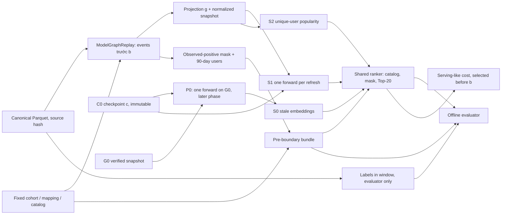

# GOAL 04 Phase D1 — kiến trúc và API contracts đề xuất

**Trạng thái:** `PHASE_D1_READY_FOR_OWNER_REVIEW` (thiết kế, chưa triển khai). Ngày 25/11/2026; audit local `develop/v2` HEAD `f28089dbc0b69d1272d21014c17dcd4617150685`, working tree sạch trước D1. Nguồn chuẩn khoa học là [protocol GOAL 04](../current/experiment-protocol.md); [D0](goal04-phase-d0.md), [Phase C](goal04-phase-c.md) và [C0 selection](../../results/goal04_training/selection.json) là evidence đầu vào. D1 không tạo P0, đọc quality development/holdout hay dùng GPU.

## 1. Kiến trúc và ranh giới dữ liệu



C0 là chính các bytes checkpoint C4 step 1500, SHA-256 `2bf073f328551561bf21941ee9fa7f3d239080139922de348f86426862a25e66`. Strict-load theo `C0Config`, G0 provenance và 90.253 × 64 tensors; không copy/rewrite checkpoint. G0 là projection v0 trước `2020-01-01T00:00:00Z`, 4.999.981 cạnh; selection manifest chỉ **tham chiếu** G0 snapshot manifest SHA `0feaa2c521b0adb364fa78468a86f8a39fac979d630053fe0cb8aff39910ebdb` và mapping SHA `996848022d92e20ef63b498cfedb38b97545fb006da4c00fef9ed35d40dc90f9`. P0 là *output propagation* của C0 trên G0, artifact mới trong phase được duyệt sau D1; không suy ra P0 từ cache C5. Fixed catalog 40.666 phim và mapping không mở rộng. S0/S1 dùng dot product trên propagated user/movie rows; S2 dùng đếm unique positive users/movie. Mọi strategy trả cùng dạng `(raw_movie_id, score)` theo `score DESC, raw movie ID ASC`, sau cùng mask lịch sử và `K=20`.

### Code → contract dependency map (audit trên chữ ký hiện có)

| Existing component | Trách nhiệm / proposed reuse | D2 cần bổ sung hoặc tránh dùng sai |
| --- | --- | --- |
| `src/graph/model_replay.py`: `create(database,cohort,events)`, `advance(boundary)`, `current()`, `state()`, `export_snapshot(output,expected_version=...)`, `load_projection_snapshot(path,expected_mapping,expected_version,expected_boundary,expected_source,materialize=...)` | Full canonical input, fixed IDs, transaction/rollback, `<b`, version/hash/degree/COO verification | Coordinator dùng API hiện có; **không** đưa filtered events vào canonical replay. State/materialize 5M edges ở Python là rủi ro RAM; đo trước khi đề xuất streaming path. `export_snapshot` yêu cầu thư mục mới. |
| `src/graph/normalize.py`: `normalized_weight`, `normalize_state`, `compare_adjacency`; `snapshot.py` | FP64 symmetric degree và toy independent normalization reference | Dùng projection exporter ở `model_replay`, không dùng `snapshot.py` canonical-version API để gán nhãn projection. |
| `src/models/lightgcn.py`: `LightGCN.forward`, `to_sparse_tensor` | 3-layer propagation, FP64 COO → FP32 sparse tensor | Adapter inference-only đếm forward và kiểm hash parameters. Không gọi `training.py`/`train_candidates`. |
| `src/models/c0.py`: `C0Config`, `load_candidate`, `load_g0` | Strict C0/G0 load, shape/config/provenance | D2 dùng `load_candidate` với nguyên provenance C4; `load_g0` chỉ v0/cutoff 2020. |
| `src/evaluation/c0_validation.py`: `score_batched`, `validation_windows`, `evaluate_embeddings` | Exact batched Top-K, stable tie; tham khảo rolling 2020 mask | D2 dùng `score_batched` cho embedding ranking, batch size đo RAM. `validation_windows` giới hạn 2020 và chỉ 4 exclusion groups; không dùng cho D/E. |
| `src/evaluation/temporal.py`: `score_chunks`, `evaluate_topk` | Chunked exact ranking, approved Recall/NDCG implementation | `split_events` là `<=`/`(,]` lịch sử, `cutoff_cohort` không phân cold/omitted; D2 tạo half-open boundary classifier riêng. Per-user rows có thể tính qua `evaluate_topk` trên singleton hoặc helper dùng đúng cùng công thức. |
| `src/evaluation/baselines.py`: `popularity_topk` | Unique positive user count từ unique edge state, tie raw ID | D2 tách helper đếm từ `popularity_topk` nếu cần cache counts/SQL streaming; giữ wrapper và semantics/tests, không viết baseline thứ hai. |
| `src/evaluation/model_cohort.py` | Approved base cohort selection/coverage provenance | Chỉ đọc fixed cohort; `prepare_cohorts` không chạy lại/không chọn lại nodes. |
| `src/benchmarking/common.py`: `RssSampler` | RSS sampler hiện chỉ đo **parent process** | D2 mở rộng/đo riêng process-tree peak (kể cả children), host RAM, DuckDB spill và GPU phases; ghi sampling interval/giới hạn. |

Existing test anchors: `tests/test_model_replay.py` đã kiểm ties, negative, replay idempotency/rollback, normalization và tamper; `tests/test_c0.py`, `tests/test_goal04_protocol_profile.py`, `tests/test_temporal_leakage.py` hỗ trợ toy fixtures. Snapshot manifest hiện có `fixed_cohort_projection_v1`, `files_sha256`, mapping/source/cohort hashes, watermark, edge/degree/COO hashes và normalization; C0 selection có checkpoint SHA/path/config và G0 manifest SHA. Các API/cache/runner dưới đây **chưa tồn tại**.

**Documentation conflict → Owner review.** `README.md` và `docs/current/scope-and-decisions.md` vẫn nói RQ2 so Fine-tuning/Retraining; đoạn tổng quát trong protocol cũng nói strategies ở mức rộng. Chi tiết GOAL 04 đã duyệt chỉ định **S0/S1/S2, S2 = popularity**, zero optimizer và không cấp fine-tuning budget. D1 theo chi tiết đã khóa; Owner cần quyết định khi nào chỉnh scope/report wording hoặc mở một nghiên cứu riêng, không ngầm thêm nhánh train. `docs/current/architecture.md` còn câu lịch sử “chưa có C0” ở mô tả Phase C2, phải đọc như trạng thái thời điểm C2; đoạn C6 mới hơn đã xác nhận C0.

## 2. Strategy và API tối thiểu cho D2

| Strategy | `prepare` nhận và tạo state | Rank / side effects / bất biến |
| --- | --- | --- |
| S0 | C0 identity + G0 identity + verified P0, fixed mapping/catalog | Mỗi boundary dùng cùng P0; chỉ mask đổi. Setup P0 về sau gọi **đúng một** LightGCN forward; sau đó S0 thêm **0** forwards/optimizer. Cache miss P0 khi đã bắt đầu repetitions là fail, không tự forward lại. |
| S1 | Cùng C0; verified updated projection/snapshot `g` tại `b`; mask/catalog | Đúng **một** forward trên normalized full eligible history mỗi scheduled refresh mỗi repetition; 0 optimizer; parameter hash trước=sau; cache embeddings phục vụ offline + benchmark trong cùng repetition. Không thêm rows cold/omitted. |
| S2 | Cùng fixed projection `<b`, mapping/catalog/mask | Unique user count/movie (edge table đã unique pairs), zero forward/optimizer; tie raw movie ID. Cache counts trong boundary/repetition; không tính từ future labels. |

Pseudocode types (chỉ là hợp đồng; `BoundaryHistory` không chứa labels, `QualityLabels` không được truyền sang strategy):

```python
@dataclass(frozen=True)
class BoundaryHistory:
    b: int                         # UTC epoch seconds, exclusive history cutoff
    source_sha256: str
    canonical_watermark_event_id: int
    last_canonical_order_key: tuple[int, int, int, int] | None
    projection_version: int
    snapshot_manifest_sha256: str
    mapping_sha256: str
    catalog_raw_movie_ids: tuple[int, ...]
    observed_mask: MaskRef       # immutable projection-backed raw-ID pairs < b
    observed_pairs_sha256: str

@dataclass(frozen=True)
class RankRequest:
    history: BoundaryHistory
    raw_user_ids: tuple[int, ...]     # caller owns offline or benchmark selection
    workload: Literal['offline_quality', 'serving_like']
    k: Literal[20]

def freeze_boundary(replay: ModelGraphReplay, b: int, *, source: Path,
                    cohort: Path) -> BoundaryHistory: ...
def make_quality_bundle(history: BoundaryHistory, *, e: int,
                        window_events: Sequence[CanonicalEvent],
                        base_cohort: BaseCohort) -> QualityBundle: ...
def select_serving_users(history: BoundaryHistory, *,
                         prior_90d_events: Sequence[CanonicalEvent]) -> BenchmarkUsers: ...
def prepare(strategy: StrategyId, history: BoundaryHistory, *,
            checkpoint: VerifiedC0, g0: VerifiedSnapshot,
            snapshot: VerifiedSnapshot | None,
            cache: CacheHandle, repetition: int) -> StrategyState: ...
def get_scores(state: StrategyState) -> Embeddings | PopularityCounts: ...
def rank_users(state: StrategyState, request: RankRequest) -> dict[int, list[tuple[int, float]]]: ...
def provenance(state: StrategyState) -> dict: ...
def counters(state: StrategyState) -> dict[str, int]: ...  # propagation_forwards, optimizer_updates
def evaluate_quality(bundle: QualityBundle,
                     ranked: Mapping[StrategyId, Ranking]) -> QualityResults: ...
```

`MaskRef` sở hữu version/hash của projection và cung cấp `seen_for(raw_user_ids) -> dict[int,set[int]]` từ cùng frozen state; không tạo thêm một bản Python của toàn bộ 5M pairs chỉ để lưu bundle. `freeze_boundary` xác minh `replay.current()` và snapshot source/mapping/version/boundary/hash; `prepare` kiểm tất cả identifiers trước cache hit/forward; `rank_users` so request history/catalog/mask hash với state và từ chối mismatch. S0/S1 gọi chung `score_batched` (hoặc `score_chunks` khi đo RAM cho cùng semantics), S2 gọi `popularity_topk`/helper đếm cùng module. Shared evaluator chấm cùng ranking theo `evaluate_topk`, không nhân ba code đánh giá. `get_scores` chỉ trả immutable read-only state, không đưa future labels vào. `StrategyState` ghi config, hashes, cache disposition, counters; model `.eval()` + `torch.inference_mode()` và không tạo optimizer. Mỗi forward **attempt** tăng bộ đếm ngay cả khi fail/timeout; reject nonfinite embeddings. Ghi explicit `no_unmasked_candidate_users`; nếu dưới 20 candidates, trả tất cả. Những request rỗng trả empty ranking; metric người không có relevant labels là absent, không phải zero.

## 3. Temporal boundary, fairness bundle và hai workloads

`[b,e)` dùng UTC monthly starts: 2021–2022 development 24 full windows, Jan–Sep 2023 final holdout 9 full windows; October 2023 partial chỉ counts descriptive. 2020 validation đã hoàn thành; không dùng để thay C0. Mỗi boundary replay **mọi** canonical events `event_ts < b`, freeze projection, snapshot, mask và strategy; rank; chỉ evaluator mới đọc unique positive labels `[b,e)`; sau window mới advance. Event đúng `b` nằm trong window bắt đầu ở `b`, không vào graph trước `b`; timestamp ties theo `(event_ts,user_raw_id,movie_raw_id,source_row_id)`, event IDs liên tiếp. 2021-01-01 S1/S2 có eligible observations 2020; S0 vẫn P0/G0. Replay state đi tiếp qua 2023, nhưng mỗi repetition tạo state riêng từ cùng base.

`BoundaryHistory` là pre-label object. `QualityBundle` là immutable envelope `{split,b,e,full_window,history_hash,cohort_manifest_sha256,mapping_sha256,catalog_raw_ids,catalog_sha256,eligible_user_ids,eligible_users_sha256,eligible_label_pairs,labels_sha256,observed_pairs_sha256,exclusions,coverage,source_sha256,v,g,snapshot_sha256}`. Raw ID lists/pairs được sort rồi hash với schema/encoding cố định; lưu cả payload và digest (hoặc content-addressed ref), không chỉ digest. Envelope được tạo sau freeze, labels nằm trong evaluator-only field/capability. Strategy `prepare`, cache và serving selector chỉ nhận `BoundaryHistory`; offline ranker chỉ nhận eligible IDs sau khi state đã freeze và không truyền labels. Trước paired comparison, assert 3 results có cùng `history_hash`, user/label/mask/catalog hashes, K, window, split, environment policy; mismatch = invalid/incomplete, không trung bình hóa.

Coverage classifier duyệt **unique positive pairs/window** theo thứ tự base-cold user → omitted user → base-cold movie → omitted movie → already-seen positive pair → eligible. Cold/omitted cố định theo base G0. Tổng sáu nhóm bằng `unique_positive_pairs`; `within_window_repeat_events = positive_events − unique_positive_pairs`. Warm-positive-pair coverage = eligible pairs / all unique positive pairs; warm-user coverage = eligible users / distinct users có positive trong window; denominator zero → null. Báo rating-event count, positive-event count, distinct eligible movies, `no_candidate_users`. Rating thấp chỉ vào rating-event count; không mask, không xóa edge. Mask gồm mọi positive `<b`, kể cả previous windows; không gồm current labels.

Offline quality: tất cả eligible warm users của window, full fixed catalog 40.666, same mask/labels; Recall@20 và NDCG@20 theo [protocol §5](../current/experiment-protocol.md). Mean user trong window, macro mean các **full windows cùng split**; pooled user-window mean là secondary riêng. Empty window: users=0, metrics=null, coverage/denominator giữ nguyên; không lặng lẽ bỏ hoặc gán zero. Paired `S1−S0` và S2 reference (`S2−S0`, `S1−S2`) trên cùng user-window; báo cả hai metrics, edge growth và staleness riêng, không suy nhân quả.

Không sampled negatives trong official ranking, không filter catalog riêng từng strategy. Support rule đã khóa: ít nhất 100 eligible users và 500 labels/window; monthly khả thi khi ít nhất 80% full development months đạt cả hai (Phase A đã kiểm). Không đổi sang quarterly hoặc chọn K/cadence theo holdout quality. Với graph không đổi, FP32 forward cùng device/dtype phải `allclose(atol=1e-6,rtol=1e-5)`; normalization FP64 dùng `atol=1e-12` hiện có. Ghi environment vì near ties có thể đổi thứ tự giữa devices.

Serving-like benchmark: chỉ từ events đã thấy trong `[b−90×86400,b)`, positive và fixed movie catalog, user thuộc fixed cohort, còn ít nhất một unmasked movie. Sort raw user IDs tăng dần, lấy tối đa 1.000; log eligible pool, selected count/hash, mask hash. Pool rỗng → `not_applicable`, ranking seconds=null. Offline và benchmark scoring chạy riêng, không reuse ranked output. Offline user selection dựa labels chỉ đi vào offline rank/evaluator, tuyệt đối không ảnh hưởng refresh, cache hay benchmark.

**Repetitions:** đúng ba, fresh isolated replay state mỗi rep, cùng C0/input. Rep 1: quality + serving-like; rep 2/3: chỉ serving-like. Thứ tự strategy lần lượt `S0,S1,S2`; `S1,S2,S0`; `S2,S0,S1`. Dùng một T4 tuần tự, không forward warm-up/extra quality pass. Mỗi rep 33 S1 forwards = 99; P0 đúng một setup forward dùng lại qua cả ba; S0 sau P0 và S2 zero, optimizer zero. S1 cache dùng lại *trong cùng boundary/repetition* cho offline và benchmark; **không** dùng S1 embedding cache của rep trước để bỏ forward của rep sau. P0 hash/reload ở mỗi rep. Failure/timeout dừng với status INCOMPLETE, attempted forward vẫn tính budget.

P0 creation/verification là setup được hạch toán vào repetition 1 và tổng wall time của thí nghiệm; hai rep sau chỉ reload/hash P0, không tạo lại. Giữ riêng `p0_setup_s` và `p0_cache_reload_s` để chi phí ban đầu không biến mất khỏi tổng charged cost.

## 4. Version, cache, storage

`v` = canonical stream watermark (`event_id` + last canonical order tuple + source SHA; `canonical_graph_version=null` khi chỉ materialize projection). `g` = fixed-cohort projection version + immutable normalized snapshot ID/hash ở cutoff `b`; g không phải canonical v. `c` = immutable C0 checkpoint bytes/config/step/provenance hash. `p` = propagated embedding bytes/manifest key từ `(c,g,mapping,config,environment)`; `b` = UTC exclusive history cutoff, không phải version. S0 `p=P0` trên G0 ở mọi b, dù mask tại b thay đổi; S1 `p_b` trên g_b; S2 không có p. Staleness ghi event-watermark lag, edge-count lag và snapshot/propagation age theo timestamp; không trừ số version khác namespace.

Proposed cache manifest `goal04_propagated_v1` (JSON, keys canonicalized before key SHA):

```json
{
  "schema_version": "goal04_propagated_v1", "strategy": "S0|S1",
  "cache_key_sha256": "sha256(canonical key fields)",
  "repetition": null,
  "checkpoint_sha256": "c", "checkpoint_parameter_sha256_before": "...",
  "checkpoint_parameter_sha256_after": "...", "checkpoint_step": 1500,
  "g0_snapshot_manifest_sha256": "...", "snapshot_manifest_sha256": "...",
  "snapshot_files_sha256": {"nodes.parquet":"...","edges.parquet":"...","degrees.parquet":"...","adjacency.parquet":"..."},
  "mapping_sha256": "...", "source_sha256": "...", "cohort_manifest_sha256": "...",
  "projection_version": 0, "boundary_utc_epoch": 1577836800,
  "canonical_watermark_event_id": 0, "last_canonical_order_key": [0,0,0,0],
  "edges_sha256": "...", "degrees_sha256": "...", "coo_sha256": "...",
  "edge_count": 4999981, "node_count": 90253,
  "dim": 64, "layers": 3, "tensor_dtype": "float32", "normalization": "symmetric_degree_v1",
  "device": "cuda:0", "environment": {"gpu":"...","torch":"...","cuda":"...","driver":"..."},
  "deterministic_inference_mode": true, "embeddings_file": "embeddings.pt",
  "embeddings_sha256": "...", "embedding_shape": [90253,64],
  "propagation_forwards_for_creation": 1, "optimizer_updates": 0, "created_utc": "..."
}
```

P0 key dùng official C0 SHA, **G0 snapshot manifest SHA plus four verified payload hashes**, mapping, dim/layers, tensor dtype và device/environment ảnh hưởng numerical compatibility; `repetition=null`. S1 key thêm repetition 1–3, projection version, `b`, updated snapshot/hash, edge/degree/COO integrity IDs, watermark. Manifest example values for watermark/tuple above are placeholders, **không là actual artifact**. Không đưa `created_utc`/output path vào key. Trước cache hit: verify SHA-256 manifest/payload, exact key, checkpoint strict reload/config/parameter hash, mapping/catalog/node shape, snapshot source/version/boundary/normalization/edge-degree-COO, dtype/device environment. Cache miss: P0 chỉ được tạo một lần ở approved setup; S1 tạo đúng một forward ở scheduled refresh của *rep đó*; thiếu/corrupt cache ở trạng thái lẽ ra đã tạo thì fail closed, không âm thầm recompute. Viết temp directory, fsync/verify payload, manifest last, atomic publish; lỗi giữ INCOMPLETE/quarantine, không nhận partial hit. Repetitions ghi independent S1 cache scope/repetition; P0 immutable shared. `load_projection_snapshot(materialize=False)` chỉ verify, không thay cho tensor load; full reload trên host đủ RAM trước propagation.

Proposed minimal layout under một run root mới (không tạo ở D1): `cache/p0/<key>/`, `cache/s1/rep-<n>/<b>-<key>/` (immutable binaries+manifest); `raw/rep-<n>/` (per-user/window/timing/coverage JSONL hoặc Parquet); `meta/` (one reproduction manifest); `logs/rep-<n>.log`; `summary/` (split comparison/report-ready tables). G0/C0 giữ nguyên ở nơi gốc, manifest chỉ tham chiếu original path/hash. Snapshot files có thể được chia sẻ **sau verify** nhưng fresh replay và 99 S1 forward contract không thay. Không xuất thêm Markdown mỗi window.

## 5. Measurement và result schemas

Mỗi timing row `{run_id,rep,split,b,e,strategy,workload,phase,seconds,status,cache_disposition,forward_attempts,optimizer_updates}` dùng `perf_counter`, CUDA synchronize trước/sau GPU phase; timers không chồng. `phase` enum: `input_integrity`, `canonical_replay`, `snapshot_export_normalize`, `snapshot_reload_materialize`, `cpu_to_gpu`, `propagation`, `embedding_cache_io`, `offline_full_catalog_rank`, `quality_aggregation`, `serving_like_rank`, `output_write`, `end_to_end_wall`; thêm `bootstrap` riêng một lần/split ở rep 1. Ghi `preparation_overhead_s` (hash/init/setup), `shared_boundary_setup_s`, `refresh_s`, `offline_quality_s=offline_rank+metric`, `serving_like_ranking_s` và `serving_like_boundary_charged_total_s` (validation/load + shared setup + strategy-specific refresh/cache + benchmark ranking) tách rõ; shared cost báo nguyên và charged total, không chia tùy ý. `run_elapsed_s` gồm mọi setup/I/O/cleanup; tổng ba run đối chiếu 30 giờ. Chỉ median/min/max ba reps cho cùng phase serving-like; không lấy mean của whole-run elapsed làm latency. `offline_quality_s` **không** là serving latency.

Resource row cùng keys + `process_tree_peak_rss_bytes`, `rss_sample_interval_ms`, `host_available_ram_min_bytes`, `duckdb_memory_limit_bytes`, `duckdb_peak_memory_bytes|null`, `duckdb_spill_bytes|null`, `gpu_allocated_peak_bytes`, `gpu_reserved_peak_bytes`, `gpu_free_min_bytes`, `gpu_name`, `cuda/driver/torch/python`, `disk_input/cache/output/spill_bytes`, `artifact_bytes`, `cache_hit|miss`, `forward_attempts`, `optimizer_updates`; unavailable counters = null + reason. GPU allocated/reserved reset theo phase; process-tree sampler phải cộng child RSS, ghi caveat 10ms có thể bỏ transient. Ghi trạng thái OOM/timeout/cap, actual versus proposed thresholds; Phase C unused budget không cộng vào D.

Raw result rows (schema version/run/protocol SHA/hash bundle bắt buộc ở từng file hoặc parent manifest):

| Output | Required fields / aggregation |
| --- | --- |
| `quality_user` (rep 1 only) | `split,b,e,strategy,raw_user_id,relevant_count,top20_raw_movie_ids,recall_20,ndcg_20,bundle_hash`; mỗi eligible user một row/strategy, không row zero cho người không có labels. |
| `quality_window` | `split,b,e,strategy,status,eligible_users,eligible_labels,mean_recall_20,mean_ndcg_20,bundle_hash,offline_quality_s`; empty → null metrics. |
| `paired_window` / `paired_split` | Cùng `(user,b)` paired `S1−S0` và S2 reference `S2−S0`, `S1−S2` cho Recall/NDCG; per-window mean rồi macro across complete windows; n windows/users/user-windows, window dispersion, optional pooled metric **labelled secondary**. |
| `coverage_window` | Six ordered pair exclusions, `unique_positive_pairs`, positive/rating events, repeats, distinct positive users, eligible users/movies/pairs, warm-pair/user fractions with denominator fields and null rules, no-candidate users. |
| `benchmark_boundary` | `eligible_pool_count,selected_count,selected_raw_user_ids_sha256,observed_mask_sha256,serving_like_ranking_s,status`; selected list/ref retained for audit. |
| `timing_resource` | Above phase/resource fields, cache policy, counts and charged totals; no quality time in serving rank. |
| `repetition_summary` | `rep,ordered_strategies,completed_boundaries,quality_windows_count,serving_windows_count,forward_attempts,optimizer_updates,p0_cache_reload,run_elapsed_s,status,error`; aggregate all 3, expected S1 99 + P0 1. |
| `reproduction_manifest` | `schema,status,approval_reference,git_head,dirty_diff_hash,protocol_sha256,selection_sha256,C0/G0/source/cohort/mapping/catalog hashes,seed,dim,layers,K,tie_rule,UTC schedule,device/environment,cache policy,all output hashes,incident log refs`. |

Bootstrap **thiết kế, không chạy ở D1**: rep 1, mỗi split riêng, 2.000 replicates seed 7; sample raw user IDs có hoàn lại, giữ toàn bộ windows của mỗi sampled user với multiplicity, tính lại mean paired user trong window rồi macro full-window estimand; percentile 2,5/97,5%, n distinct users/user-windows/windows. Empty resample/window phải ghi null/invalid replicate, không đổi estimand âm thầm. CI conditional trên C0/seed, không bao training-seed hoặc temporal-shock uncertainty. `<100` distinct users hoặc `<6` full windows chỉ descriptive; nhiều metrics/windows có multiplicity, không chọn riêng tháng có lợi. Holdout không mở khi development/policy chưa khóa và Owner chưa cho phép.

Later reporting wiring (chỉ sau đo/verify): `claim-evidence-map.md` nhận claim ID R2-05, run/status, exact raw result/manifest hashes, paired CI và limitations; `report-draft.md` mục 4 nhận protocol/cache/timer, mục 5 nhận quality-window/paired/coverage/cost tables, mục 6 nhận bias/low-support/multiplicity; `slide-storyboard.md` slide 5 nhận fairness diagram, slide 11 nhận measured paired quality versus refresh/serving cost (nếu thực có), slide 12 nhận limits/conclusion. Các file reporting hiện giữ placeholder; D1 không điền numerical gains.

## 6. D2 implementation blueprint và CPU toy gates

Mỗi file dưới đây là **đề xuất D2**, không tồn tại/không sửa ở D1. Tests chạy synthetic CPU và temp dirs; không benchmark real 5M. Caller chính là một mỏng experiment runner ở phase được duyệt; core graph/model không import runner. Config đọc từ official selection/protocol, không mở hyperparameter framework.

| File / API | Responsibility, input → output, reuse/dependencies | Invariant, failure mode, toy acceptance |
| --- | --- | --- |
| `src/evaluation/refresh_boundary.py`: `freeze_boundary`, `make_quality_bundle`, `select_serving_users` | Orchestrate `ModelGraphReplay.advance/current/export_snapshot`; build pre-label history/mask/90d users, separate evaluator-only labels; reuse canonical validation and cohort manifest. | Reject `>=b` history, mapping/source mismatch, invalid UTC/order, wrong exclusion partition. Tests 1–7, 11, 15–16; exact independent projection/normalization and no-leakage PASS. |
| `src/models/refresh_cache.py`: `cache_key`, `load_verified`, `publish_atomic`, `parameter_sha256` | Content-addressed P0/S1 embeddings manifest and strict `load_candidate`/snapshot checks; `file_sha256`, `load_projection_snapshot`; no optimizer. | Reject missing/corrupt/stale/mismatched, unchanged parameters, partial publish not hit. Tests 8–9, 13–14; P0 one setup forward and subsequent zero; S1 rep-scoped. |
| `src/evaluation/refresh_strategies.py`: `prepare/get_scores/rank_users/provenance/counters` | Three thin adapters; call `LightGCN.forward` only S1/P0 setup; reuse `score_batched`/`score_chunks`, `popularity_topk`; shared request validator. | Equal users/catalog/mask, exact score/tie, zero optimizer, forward counts. Tests 8–12, 14–15; mismatch fails closed. |
| `src/evaluation/baselines.py`: small `popularity_counts` helper + existing `popularity_topk` wrapper if count caching needed | Reuse one popularity implementation with unique edges; avoid duplicate S2 logic. | Existing callers/tests retain order/API; toy tests 4, 10, 12. |
| `src/evaluation/refresh_results.py`: `evaluate_quality`, `aggregate_split`, `paired_bootstrap` | Reuse `evaluate_topk` formula, emit per-user/window/coverage and paired macro/CI; only evaluator sees labels. | Null empty, exact macro, user-cluster resample, no pooled substitution. Tests 11, 15, 17 and deterministic bootstrap toy. |
| `src/benchmarking/goal04_refresh.py`: `run_repetition`, phase timer/resource serializer | 3 fixed orders, isolated replay, cached P0 reload, same serving cohort; reuse/extend `RssSampler`, perf_counter/CUDA sync. | Rep 1 only quality, no hidden forward, counters and charged totals exact, stop on cap. Tests 8–9, 17 on CPU clock/mock. |
| `tests/test_goal04_refresh_*.py` | Synthetic fixtures for source/cohort/C0/projection and cache tampering; existing `test_model_replay.py`, `test_c0.py`, `test_goal04_protocol_profile.py` patterns. | 17 required scenarios below PASS, no real data/GPU needed. |

Call signatures planned for file map (all returned records carry schema/version/status and validate input before side effects): `cache_key(checkpoint: VerifiedC0, snapshot: VerifiedSnapshot, mapping_sha256: str, runtime: RuntimeIdentity, *, repetition: int|None) -> str`; `load_verified(path: Path, expected_key: str) -> Embeddings`; `publish_atomic(path: Path, embeddings: Tensor, manifest: CacheManifest) -> CacheManifest`; `parameter_sha256(model: LightGCN) -> str`; `aggregate_split(rows: Sequence[QualityWindow], split: str) -> SplitMetrics`; `paired_bootstrap(per_user_rows: Sequence[QualityUser], *, seed: Literal[7], replicates: Literal[2000]) -> PairedCI`; `run_repetition(rep: Literal[1,2,3], selection: VerifiedSelection, source: Path, cohort: Path, p0: CacheHandle, out: Path) -> RepSummary`. `cache_key` dùng `repetition=None` cho P0, rep 1–3 cho S1. Mọi output path mới (`exist_ok=False`), failure → INCOMPLETE record và không publish partial cache.

Toy matrix: **(1)** equal timestamp including several tied canonical rows; **(2)** future edge/label cannot reach graph/cache/serving selector; **(3)** repeated positive pair is one edge/label; **(4)** low/negative does not mask/delete; **(5)** fixed mapping/catalog rejects cold expansion; **(6)** replay equals independent full projection; **(7)** new edge changes *all affected* normalized degrees/weights; **(8)** S0 zero forwards after P0 and same P0 all b; **(9)** S1 exactly one forward/0 optimizer per rep/b; **(10)** S2 counts only `<b` unique users; **(11)** three strategies same IDs/mask/catalog/labels; **(12)** stable Top-20 ties including insufficient candidates; **(13)** missing/corrupt/wrong-version cache rejected; **(14)** C0 parameter hash unchanged; **(15)** empty labels → null, zero available candidates → benchmark not applicable; **(16)** replay no-op and rollback after injected failure; **(17)** exact 3 orders/quality only rep 1 and disjoint timers. Acceptance: all tests CPU PASS, existing 103-test baseline still PASS when D2 code lands, exact call counts and manifest/hash assertions PASS; no source change authorized by this D1 document.

## 7. Performance/budget risks và review options

Current `ModelGraphReplay._attach_source()` rehashes full canonical file on open/advance/export; `_check_state()` and `_record()` call `state()` and hash whole registry/edges/degrees, materializing roughly 5M edge tuples in Python. Snapshot export/verification rereads four Parquets and normalization, `load_projection_snapshot(materialize=True)` materializes all adjacency tuples before `to_sparse_tensor`; CPU→GPU transfer and sparse propagation compete for memory. `score_batched` scores `batch_size × 40,666`; `score_chunks` uses smaller chunks but Python overhead. Existing `RssSampler` is parent-only. D0 had ~3.1 GiB free local RAM, insufficient evidence for fresh full reload; C3 one-boundary probe cannot prove 99 runs.

Future *review* options: profile repeated full SHA and fuse hashing with mandatory file scans without dropping any verification boundary; move state checksum to bounded DuckDB batches and avoid duplicate `state()` materialization; reuse already verified snapshot within the same boundary/repetition; bounded sparse/tensor loading and smaller rank batches; phase-level resource telemetry and disk-spill planning. Each optimization needs toy equivalence/tamper checks and actual preflight measurement; none changes 99 S1 forwards, one P0 forward, full catalog or three reps. Proposed limits: S1 forward ≤60s, graph/snapshot setup ≤300s/boundary, offline quality ≤900s/strategy/window, serving rank ≤300s/strategy/window, three reps ≤30h end-to-end. These are **planning caps**, not feasibility proof or GPU authorization; timeout/OOM → INCOMPLETE, no downsizing or extra retry. C-phase remaining budget is unavailable to D.

## 8. Open questions / Owner gate

1. `OWNER_DECISION_REQUIRED` — scope wording: retain broad RQ2 Fine-tuning/Retraining as future research, or edit general scope/README after Owner approval to reflect only approved S0/S1/S2. Both leave current GOAL 04 protocol intact; first leaves a documented mismatch, second requires separate wording decision. No fine-tuning work is in D2.
2. `OWNER_DECISION_REQUIRED` before any GPU phase: review actual resource preflight and approve Phase D execution/budget separately. D1 supplies contracts only; D2 CPU tests do not prove 30-hour feasibility.
3. RAM/performance implementation choice after D2 toy profiling: existing materialization or integrity-preserving streaming path. Same scientific outputs/forward counts required; stop if memory cap cannot be met.

**Owner acceptance checklist:** [ ] approve S0/S1/S2 + shared bundle/API; [ ] accept P0 one-time and S1 per-rep forward/cache rules; [ ] accept temporal/exclusion/coverage and two-workload boundaries; [ ] accept manifest/timer/result schemas and D2 toy gates; [ ] decide general scope wording; [ ] authorize D2 separately. Do not infer approval of real-data/GPU/holdout from D1 acceptance.

## 9. D1 documentation verification

Đã đối chiếu API đề xuất với chữ ký của 10 module bắt buộc, snapshot/checkpoint schemas và toy tests hiện có; biên `<b`/`[b,e)`, six ordered exclusions, identical masks/catalog/users và ba repetition orders khớp [protocol](../current/experiment-protocol.md). Design không có optimizer/training path hay đề xuất mở holdout trong development; timer phân biệt setup/refresh, offline quality và serving-like ranking. Local Markdown links của hai file D1: 0 broken; `git diff --check`: PASS; chỉ `docs/research/goal04-phase-d1.md` và `docs/current/architecture.md` thay đổi. Baseline **103 tests PASS** được ghi từ [D0](goal04-phase-d0.md)/[Phase C](goal04-phase-c.md); D1 **không rerun** regression vì chỉ sửa tài liệu. Không thực hiện real-data scoring, cache creation, GPU hoặc source edits.
